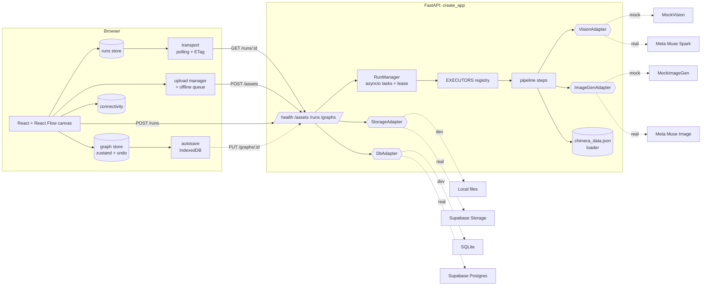

# Architecture

Chimera Lab is a React node canvas (frontend) talking to one FastAPI app (backend) that runs locally with uvicorn or on Modal. Every external service sits behind an adapter with a mock and a real implementation, selected by `CHIMERA_MODE` and by whether Supabase credentials are present.



## Node registry (frontend and backend)

Each node type is defined once (`frontend/src/nodes/types.ts`, `NodeDefinition`), with:

- its `type` and `version`
- its `inputs` and `outputs` ports
- default config and data
- a `validate()` for pre-run checks
- a `View` for the canvas, plus an optional side `Panel`
- whether it is `runnable`
- an optional `migrate()`

`nodes/registry.ts` lists the definitions. The canvas builds its React Flow node types, tool rail buttons, validation and side panel from the registry alone. Unknown types fall back to the `unsupported` placeholder.

The backend mirrors this: `pipeline/registry.py` maps a node type to an `Executor` that resolves its inputs from the graph and returns its ordered `StepDef`s. The UI renders whatever steps the run reports, so a new step shows up with no UI change.

Port data types in v1 are `image` and `creature`. The edge rule (`graph/edgeRules.ts`): the source port's `emits` must be in the target port's `accepts`, the target port must be free (unless `many`), and the edge must not create a cycle.

## Graph document

```json
{ "schemaVersion": 1, "graphId": "uuid",
  "nodes": [{ "id": "fusion-1a2b", "type": "fusion", "version": 1, "position": {"x":0,"y":0}, "config": {}, "data": {"activeRunId": "run_…", "runIds": []} }],
  "edges": [{ "id": "e1", "source": "image-input-…", "sourcePort": "out", "target": "fusion-1a2b", "targetPort": "a" }] }
```

`graph/migrate.ts` (`loadGraph`) runs schema migrations (v0 → v1 exists), per-node migrations, removes orphan edges and duplicate ids, and coerces bad positions. A newer schema opens read-only, and garbage throws `GraphLoadError` (autosave then discards it with a toast).

## Run lifecycle

```mermaid
sequenceDiagram
  participant U as Fusion node
  participant R as runs store
  participant API
  participant M as RunManager
  U->>R: start(nodeId)
  R->>API: POST /runs {graph,nodeId} + Idempotency-Key
  API->>API: validate (GRAPH_INVALID / DUPLICATE_INPUTS), rate limit
  API->>M: start task (fault from X-Mock-Fault, mock mode only)
  API-->>R: 201 Run(queued, steps pending) + ETag
  R->>U: activeRunId; Fusion handler creates the Result node (skeleton)
  loop every 1.5s, 5s after 60s; paused while offline
    R->>API: GET /runs/:id (If-None-Match)
    API-->>R: 304, or Run with step statuses
  end
  M-->>API: steps load_inputs → identify → match → hybrid_check → rules_check → compile → generate → store
  R->>U: succeeded → version appended to the Result node
```

- **Statuses:** `queued | running | succeeded | failed | cancelled | interrupted`.
- **Steps:** `pending | running | succeeded | failed | skipped`.
- **Version:** every save bumps `version` (the ETag).
- **Heartbeat:** keeps `updatedAt` fresh. A run whose heartbeat is older than the lease is marked `interrupted` when read.
- **Cancel:** cancels the task and marks the remaining steps `skipped`.
- **Retries:** `pipeline/retry.py` retries `RATE_LIMITED`, `UPSTREAM_TIMEOUT` and `UPSTREAM_ERROR` (1s, 2s, 4s, honouring `retryAfterMs`). Per-attempt timeouts are 30s for identify and 120s for generate.
- **Spend guard:** `pipeline/context.py` charges every attempt against `MAX_VISION_CALLS_PER_RUN`, `MAX_GENERATIONS_PER_RUN` and the daily `DAILY_GENERATION_CAP` counter, and stops retrying when the budget is spent.

## Pipeline (v1 fusion)

| Step | Module | Notes |
|---|---|---|
| load_inputs | `steps/load_inputs.py` | fetch both assets, verify decode, distinct sha256 |
| identify | `steps/identify.py` | parallel `describe_animal`; human → `HUMAN_DETECTED`, non-animal → `NOT_AN_ANIMAL`, with `failedInput` slot |
| match | `steps/match.py` | scientific name → common name/alias → genus; tier 1 then tier 2; unmatched is allowed |
| hybrid_check | `steps/hybrid_check.py` | unordered pair lookup in `hybrids`; exact order first |
| rules_check | `steps/rules_check.py` | rules keyed by their `check` field run as Python predicates; warnings only |
| compile | `steps/compile.py` | `plan_fusion` (structured output) gives body plan + part donors; prompt from `compile_template.txt` |
| generate | `steps/generate.py` | both images as references; output must decode or it's `UPSTREAM_ERROR` (retryable) |
| store | `steps/store.py` | image asset + creature record with parent asset ids (lineage) |

## Frontend state

| Store | File | Holds |
|---|---|---|
| graph | `graph/store.ts` | nodes, edges, selection, read-only flag, undo/redo (100 steps), revision counter |
| runs | `runs/store.ts` | runs by id, start errors, double-start guard; transport behind `runs/transport.ts` |
| connectivity | `connectivity/store.ts` | browser online + `/health` heartbeat (15s, and immediately on failed requests) → `online / offline / unreachable` |
| ui | `ui/uiStore.ts` | theme, minimap, open panel, test crash flags |
| toasts | `ui/toastStore.ts` | queued notices |

Persistence: `persistence/autosave.ts` writes the graph to IndexedDB (500ms debounce, 2s max wait, flush on page hide) and PUTs it to `/graphs/:id` when online. `persistence/blobStore.ts` keeps the local copy of each input image, so previews and queued uploads survive reloads and offline periods.

## Errors

The backend raises `ChimeraError(code, message, retryable, retry_after_ms, details)`. Every non-2xx response, including validation, 404 and unhandled errors, uses the envelope `{ error: { code, message, retryable, retryAfterMs, details, errorId } }`. The frontend maps each code to exactly one message in `api/errorMessages.ts` and never shows server or upstream text. Client-only codes are `NETWORK`, `OFFLINE`, `ABORTED` and `UNKNOWN`.

## Types

`backend/app/models/schemas.py` is the single source of API types. `scripts/gen_types.sh` exports the JSON schema and turns it into `frontend/src/types/api.ts` (json-schema-to-typescript).

## Test hooks

When Vite runs with `--mode test`, `src/test-hooks/install.ts` exposes `window.__chimera`:

- `setFault` (forwards `X-Mock-Fault`)
- `force` (connectivity)
- `crashNode` / `crashApp`
- `setRun` (synthetic run, polling frozen)
- `writeAutosave`
- `graph`

Production builds strip these, which `scripts/check-bundle.sh` verifies.
