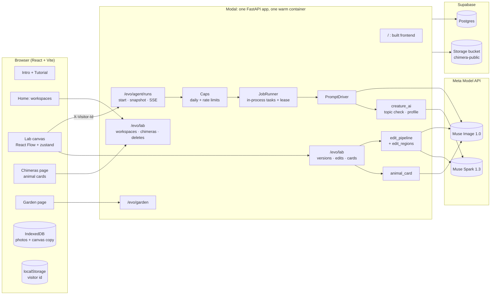
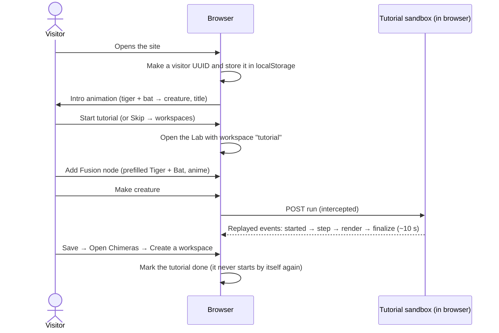
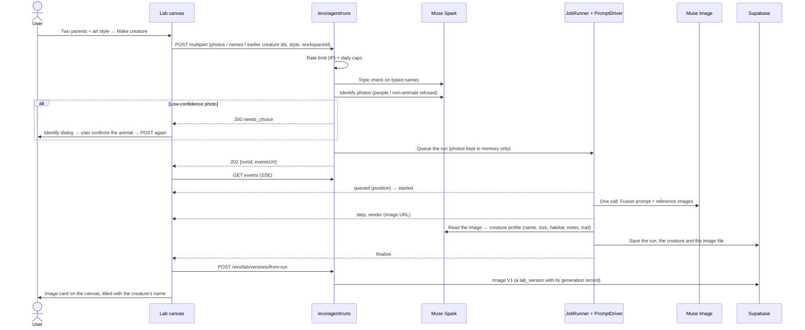
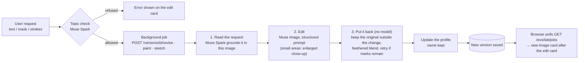
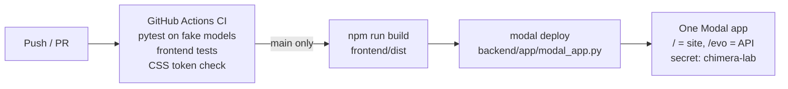

# Chimera Lab: Architecture

Chimera Lab turns two animals into one creature. You give it two parents (photos, typed names or earlier creatures)
and an art style. Muse Image draws the hybrid, and Muse Spark names it and writes its field-guide entry. You can then
revise, paint over or draw on the creature, save it as an animal card and share it to a public Garden.

This document covers the system as a whole: the components, how a request moves through them, and every user
journey from first visit to the shared Garden.

---

## 1. System at a glance

| Layer | Technology | Role |
|---|---|---|
| Frontend | React, TypeScript, Vite, React Flow, zustand, idb-keyval | Node canvas, screens, autosave, SSE client |
| Backend | Python, FastAPI, Pillow | API, job runner, prompt building, image compositing |
| Models | Meta Model API: **Muse Image 1.0**, **Muse Spark 1.3** | All image generation; vision, safety and writing |
| Data | Supabase Postgres + Storage (local fallback: SQLite + a folder) | Workspaces, runs, versions, cards, image files |
| Hosting | Modal (one app), GitHub Actions CI/CD | Serves `/` (site) and `/evo` (API) from one origin |

---

## 2. Core components

### Frontend (`frontend/src`)

| Component | Where | What it does |
|---|---|---|
| **Router** | `app/route.ts` | Query-string routes: `/` (home), `/?ws=<id>` (Lab), `/?ws=<id>&run=<id>` (follow a run), `/?view=chimeras`, `/?view=garden` |
| **Intro** | `intro/Intro.tsx` | First-visit animation: a tiger and a bat glitch into one creature, then the title drops |
| **Tutorial** | `tutorial/Tour.tsx`, `tourStore.ts`, `sandbox.ts` | Hands-on walkthrough in the real Lab; its API calls are answered in the browser from a recorded run |
| **Screens** | `screens/` | `HomePage` (workspace tiles), `LabView` (canvas + tools panel), `ChimerasPage`, `GardenPage` |
| **Canvas** | `canvas/` | React Flow canvas, tool rail, drop menu (drag off an image), add-image library dialog, zoom |
| **Node types** | `nodes/` + `registry.ts` | `image-input` (photo/name), `fusion`, `version` (a generated image), `edit` (Revise/Paint/Draw), `card` |
| **Graph store** | `graph/` | Versioned canvas document, edge rules (type match, free port, no cycles), undo, migrations |
| **Persistence** | `persistence/` | Autosave per workspace (IndexedDB at once, server debounced), local photo blobs |
| **Fusion client** | `evo/` | Start runs, SSE parser with resume (`Last-Event-ID`), run snapshots, limits |
| **Lab client** | `lab/` | `/evo/lab` API, edit-job polling, tools panel, paint/draw editor, animal card view, deletion |
| **Connectivity** | `connectivity/store.ts` | Online / offline / server-unreachable banner state |
| **Session** | `api/session.ts` | Creates the random visitor UUID once and sends it as `X-Visitor-Id` |

### Backend (`backend/app`)

| Component | Where | What it does |
|---|---|---|
| **App** | `main.py`, `modal_app.py` | Builds FastAPI, mounts routers, serves the SPA last; Modal entrypoint |
| **Identity** | `auth.py` | Reads `X-Visitor-Id` (must be a UUID). No sign-in; the id owns all of the visitor's data |
| **Fusion routes** | `agentapi/routes.py` | `POST /evo/agent/runs`, run snapshot, SSE events, limits, files |
| **Uploads** | `agentapi/uploads.py` | Sniff, size-check and resize photos; identify the animal with Muse Spark |
| **Caps** | `agentapi/caps.py` | Daily total and per-visitor runs (reset 00:00 UTC), per-IP rate limit per minute |
| **JobRunner** | `agentapi/jobs.py` | In-process asyncio tasks: queue with positions, concurrency limit, heartbeat lease, hard time cap |
| **PromptDriver** | `agentapi/jobs.py` | Builds the prompt, calls Muse Image once, writes the profile, saves the creature |
| **Fusion prompt** | `agentapi/fusion_prompt.py` | Base prompt, reference sentences, "blend the animals, not the art styles", style, white background |
| **Creature AI** | `agentapi/creature_ai.py` | **Topic check** (only animal-chimera text is allowed) and **creature profile** (name, size, habitat, notes, trait) |
| **Lab** | `agentapi/lab.py` | Versions, Revise/Paint/Draw jobs, final pick, download, animal cards, jobs list |
| **Edit pipeline** | `agentapi/edit_pipeline.py`, `edit_regions.py` | Read the request → edit → put back (masking, crop-and-stitch, feathered blend) |
| **Animal card** | `agentapi/animal_card.py` | Profile + four more angles (front, side, back, above), made in the background |
| **Library** | `agentapi/library.py` | Workspaces, saved chimeras, profile edits, Garden sharing, real deletes |
| **Adapters** | `adapters/` | `meta/` (models), `supabase/` (Postgres + Storage), `local/` (SQLite + files), `retrying.py` (backoff) |

---

## 3. User journeys

### Journey 1: First visit (intro, then tutorial)

- The intro shows only on a first visit to the home route.
- The tutorial runs in the **real Lab UI**: real canvas, real Fusion node, real progress and image card. The glowing
  element is always the next thing to click.
- `tutorial/sandbox.ts` answers every call that belongs to the tutorial (ids `tutorial`, `tutorial_v1`,
  `tutorial_run_*`) with a creature made once with the live models (`public/example/`). **It makes no model calls
  and nothing reaches the server.** The animal card also "draws" itself from the recording.

### Journey 2: Workspaces (home)

1. `/` lists the visitor's workspaces (`GET /evo/lab/workspaces`) as tiles.
2. **New workspace** → `POST /evo/lab/workspaces` → opens `/?ws=<id>`.
3. The canvas autosaves: to IndexedDB at once, and to the server (`PUT /evo/lab/workspaces/<id>`) debounced
   (1.5 s, at most 6 s). If the server can't be reached, the local copy is used and uploaded on the next save.
4. **Delete workspace** → `DELETE /evo/lab/workspaces/<id>` removes the workspace and every image made in it, unless
   another workspace's canvas still shows that image.

### Journey 3: Make a creature (Fusion)

**Parents.** Each slot (sire/dam) is one of:
- **A photo.** Resized, then identified by Muse Spark. A person or a non-animal is refused. A low-confidence reading
  opens the **Identify dialog** so the user confirms the animal.
- **A typed name.** Must pass the topic check (real, extinct or mythical animals; no people, brands or chat).
- **An earlier creature** (`sireVersionId` / `damVersionId`). Its image is the reference and its profile names it,
  so creatures can be fused again across generations.

**Art styles:** real, drawing, anime, comic, cartoon, always on a white background.

**Live progress.** The browser follows the run over SSE (events `queued`, `started`, `step`, `render`, `finalize`,
`error`). The URL carries `run=<id>`, so a reload or a dropped connection (Modal cuts requests at 150 s) **resumes
from the last event**. Runs have a hard time cap; nothing is saved from a failed run.

**Privacy.** Uploaded photos stay in the browser's IndexedDB. They are sent only as references for one call and are
never stored on the server.

### Journey 4: Edit a creature (Revise, Paint, Draw)

Drag off any image card (drop menu) or use the tools panel to add an **edit node**. Each edit makes a **new child
image**, so the canvas becomes a family tree of versions.

| Edit | The user gives | What the model gets |
|---|---|---|
| **Revise** | A sentence ("give it feathered wings") | The image + a precise, grounded instruction |
| **Paint** | A brushed area (+ optional text) | A marked copy + the clean image; the area is filled with parts of the parent animals |
| **Draw** | Strokes sketched on the image | The drawing + the clean image; the strokes become body parts |

- Edits run as in-process background jobs with named stages ("Reading your request", "Revising the image",
  "Updating the creature's entry", "Saving the new version"). The browser polls `GET /evo/lab/jobs` while any edit is
  running and picks jobs up again after a reload. A job cut off by a restart is marked *interrupted*.
- Edits count against the same daily budget as Fusion runs.
- The **tools panel** shows the selected image's **path** (from the Fusion down to this version) and **Compare**, and
  offers download, save and delete.

### Journey 5: Save a chimera and its animal card

1. **Save to chimeras** (drop menu or tools panel) → `PUT /evo/lab/versions/<id>/saved`.
2. Saving starts the **animal card** in the background: the profile text plus **four more angles** (front, side, back,
   three-quarter from above), each drawn by Muse Image with the image as the reference.
3. `/?view=chimeras` lists saved creatures newest first (`GET /evo/lab/chimeras`). Cards show small and open in a
   modal; a card that is still drawing shows progress, and a failed or interrupted card can be made again.
4. Card text (name, length, weight, habitat, notes) is editable (`PUT /evo/lab/versions/<id>/profile`). A new name
   must still pass the topic check.
5. A card can also be placed on the canvas as a **card node**.

### Journey 6: Share to the Garden

1. On a saved creature, **Share to Garden** → `PUT /evo/lab/versions/<id>/garden`. Sharing also saves the creature and
   starts its card if it has none.
2. `/?view=garden` (`GET /evo/garden`) shows every shared creature from every visitor, newest first. It needs no
   visitor id.
3. Only creatures whose card is ready are shown, and only the card: **never the owner or the workspace**. Your own
   creatures are marked `mine`, so you can take them back.

### Journey 7: Reuse, add images, and fuse again

- **Add image** opens the library: everything you have generated (`GET /evo/lab/versions`), your photos on this
  device (IndexedDB) and upload.
- **Fuse with another animal** (drop menu) wires an existing creature into a new Fusion node as a parent, so a
  creature's grandchildren carry its traits and its profile.
- Edge rules on the canvas only allow connections whose types match, into a free port, without cycles.

### Journey 8: Delete

- **Delete an image** (confirmation first) → `DELETE /evo/lab/versions/<id>`: removes the record, the image file, the
  card's angle files and, for a Fusion's first image, its run and creature records. Undo history is cleared, so undo
  can't bring back a card whose image is gone.
- **Delete a photo** removes it from this device only.
- **Delete a workspace**: see Journey 2.

### Journey 9: Limits, errors and offline

- **Lifetime image limit** (`ImageQuota` in `agentapi/caps.py`): each visitor can generate **30 images in total**
  (`EVO_VISITOR_IMAGE_LIMIT`). A Fusion or an edit uses 1, an animal card 4. It never resets and is on even when
  the daily caps are off. The counter (`counters`, key `images:v:<visitor id>`) is taken before the model is called
  and given back if nothing is delivered (a failed run or edit, or card angles that weren't drawn). The top bar shows
  "N of 30 images left". At 0, Make creature and Generate are disabled with a message, and the server refuses with
  `429 CAP_REACHED` (`scope: visitor_images`). Saving with fewer than 4 left still saves; the card says why it wasn't drawn.
- **Caps** (`agentapi/caps.py`): a daily total, a per-visitor daily budget (both reset at 00:00 UTC; `429
  CAP_REACHED`), and a per-IP sliding-minute rate limit (`429 RATE_LIMITED` with `Retry-After`). Extra concurrent
  runs are queued and show their position. The UI shows usage from `/evo/agent/limits` and `/evo/lab/limits`.
- **Refusals** (topic check, people in photos, bad files) come back as friendly messages on the node that caused them.
- **Retries**: model calls share one retry policy (`app/retry.py`): a per-attempt timeout and backoff on rate limits
  and retryable upstream errors.
- **Connectivity**: banners for offline and server-unreachable; the canvas keeps saving locally and syncs later.

---

## 4. Data model (Supabase)

| What | Table / bucket | Key |
|---|---|---|
| Workspaces (canvas documents) | `graphs` | `ws:<visitor id>:<workspace id>` |
| Fusion runs and their events | `agent_runs` | `runId` |
| A run's creature | `creatures` | `creatureId` |
| Images (versions) and edit jobs | `assets` | `kind` = `lab_version` or `lab_job`; `owner`, `workspaceId`, `garden` |
| Daily caps | `counters` | via `incr_counter` |
| Image files | Storage bucket `chimera-public` | `runs/…`, `lab/…` (unlisted random keys) |

Each version stores its **generation record**: operation, instruction, prompt, model, parents and profile. Later
steps build on it: edits keep the creature's identity, cards reuse the profile, and fusing again reuses the parent's
summary.

Row level security is on for every table with no policies, so only the backend's `service_role` key can read or
write. The browser never talks to Supabase directly.

---

## 5. Identity and security

- **No sign-in.** Each browser makes a random UUID on its first visit and sends it as `X-Visitor-Id`. It owns that
  visitor's workspaces, images and caps. Another visitor's run or image reads as *not found*, so nothing leaks.
  Clearing site data starts over.
- **Content safety** happens before any image call: the topic check on all user text, and identification of every
  photo (people refused).
- **Photos** never leave the device except as a reference for one model call.
- **The Garden** strips the owner and workspace from everything it returns.

---

## 6. Build, test and deploy

- **Locally:** `scripts/dev.sh` runs Vite on port 5173, which proxies `/evo` and `/health` to FastAPI on port 8000
  (one origin, as in production). Without Supabase keys, SQLite and a local folder stand in.
- **Tests** never call paid models: `backend/tests/fakes` and `frontend/tests/fakes` replace them, and the tests
  never read `.env`.
- **Deploy:** every push to `main` runs the checks, then deploys to Modal. Setup and rollback are in
  [`DEPLOY.md`](DEPLOY.md).

---

## 7. Design constraints

- **One process.** Runs, edits and cards are in-process tasks with a heartbeat lease and orphan recovery, so the host
  keeps one warm container. Moving jobs to Modal functions would lift this.
- **Live models only.** The app always calls the real models; only the tutorial (a recorded replay) and the tests
  (fakes) don't.
- **One model call per image.** Fusion is a single Muse Image call with references. The anatomy-planning agent this
  replaced is described in [`HISTORY.md`](HISTORY.md).
