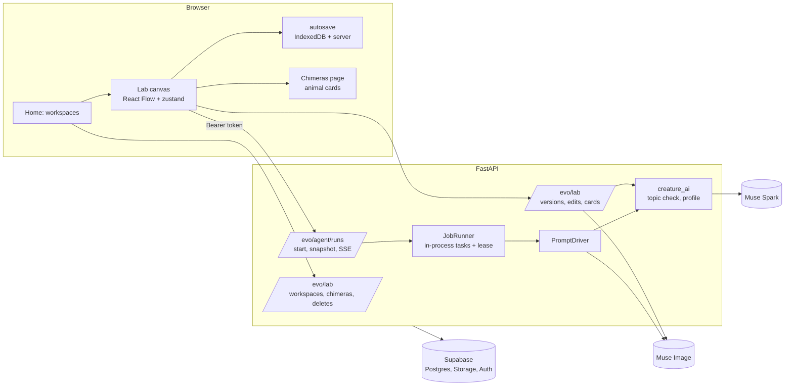

# Architecture

One FastAPI app serves the API under `/evo` and the built React app at `/` (one origin, no CORS). Models are Meta's
(Muse Image, Muse Spark); data, images and sign-in are Supabase's. Locally, without Supabase, a SQLite file and a
folder stand in.

## The flow

1. **Fusion** (`POST /evo/agent/runs`, `agentapi/routes.py`): each slot is a photo, a typed name or an earlier
   creature (`sireVersionId`). Typed names pass the topic check; photos are identified by Muse Spark (people and
   non-animals refused; a low-confidence read asks the user). The run is queued in the `JobRunner` (`jobs.py`).
2. **PromptDriver** builds the prompt (`fusion_prompt.py`: the base prompt, reference sentences, "blend the animals,
   not the art styles", the art style, the white-background rule), calls Muse Image once with the photos or earlier
   creatures as references, then has Muse Spark write the creature's profile (`creature_ai.py`). Events stream to the
   browser over SSE (`started`, `step`, `render`, `finalize`).
3. **Image V1** (`POST /evo/lab/versions/from-run`, `lab.py`): the run's creature becomes the first version, with its
   generation record (prompt, style, parents, profile) and its workspace.
4. **Edits** (`revise`, `paint`, `sketch`): background jobs that each make a child version. Paint and Draw send a
   marked copy and the clean image, and fill the marked area with parts of the parent animals. Every edit updates
   the profile (the name is kept).
5. **Animal card** (`animal_card.py`): one per image, made in the background when the image is saved (or asked for):
   the profile plus four more angles drawn by Muse Image from the image.
6. **Library** (`library.py`): workspaces (`graphs` rows `ws:<user>:<id>`), saved chimeras, and real deletes (the
   record, the image and its angle files, and a Fusion's run records).

## Data (Supabase)

| What | Where |
|---|---|
| Workspaces (canvas documents) | `graphs`, key `ws:<user id>:<workspace id>` |
| Fusion runs and their events | `agent_runs` |
| A run's creature | `creatures` |
| Images (versions), edit jobs | `assets` (`kind` `lab_version` or `lab_job`, `owner`, `workspaceId`) |
| Daily caps | `counters` (`incr_counter`) |
| Image files | public bucket `chimera-public` (`runs/…`, `lab/…`), unlisted random keys |

Row level security is on for every table with no policies; only the backend's `service_role` key can read or write.
Uploaded photos stay on the user's device (IndexedDB) and are sent only as references for one call.

## Frontend

- `screens/`: Home (workspace tiles), Lab (canvas + tools panel), Chimeras (saved creatures as cards).
- `nodes/`: one folder per node type (image input, Fusion, image, edit, animal card) registered in `registry.ts`.
- `graph/`: the versioned canvas document, edge rules, undo; `persistence/`: autosave per workspace, local blobs.
- `evo/`: the Fusion API client (runs, SSE with resume, limits); `lab/api.ts`: everything under `/evo/lab`.

## Constraints

- **One process.** Runs, edits and cards are in-process tasks (with a heartbeat lease and orphan recovery), so the
  host keeps one warm container. Moving jobs to Modal functions would lift this.
- **Live-only.** The app always calls the real models; tests swap in fakes (`backend/tests/fakes`,
  `frontend/tests/fakes`) and never read `.env`.
