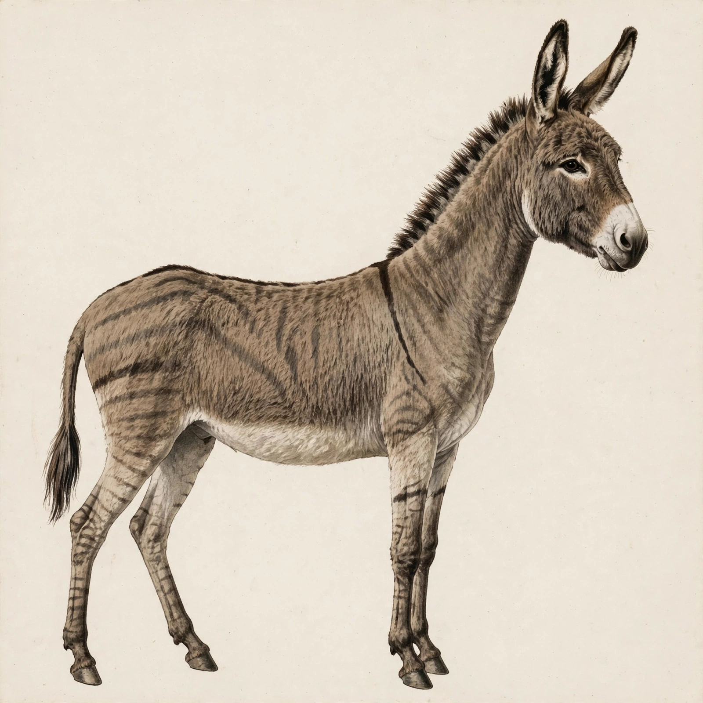
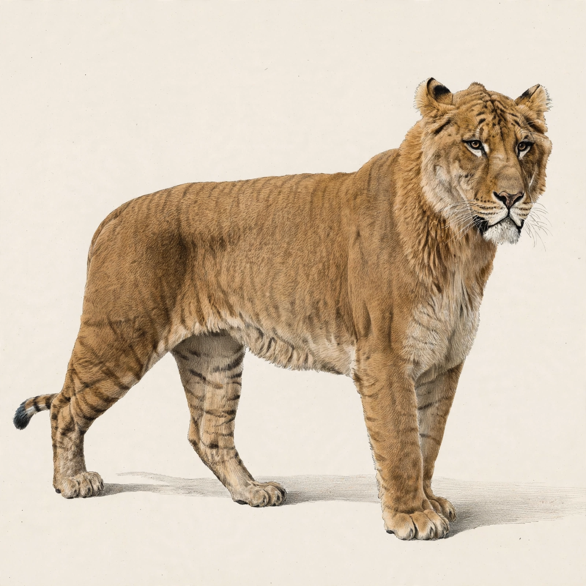
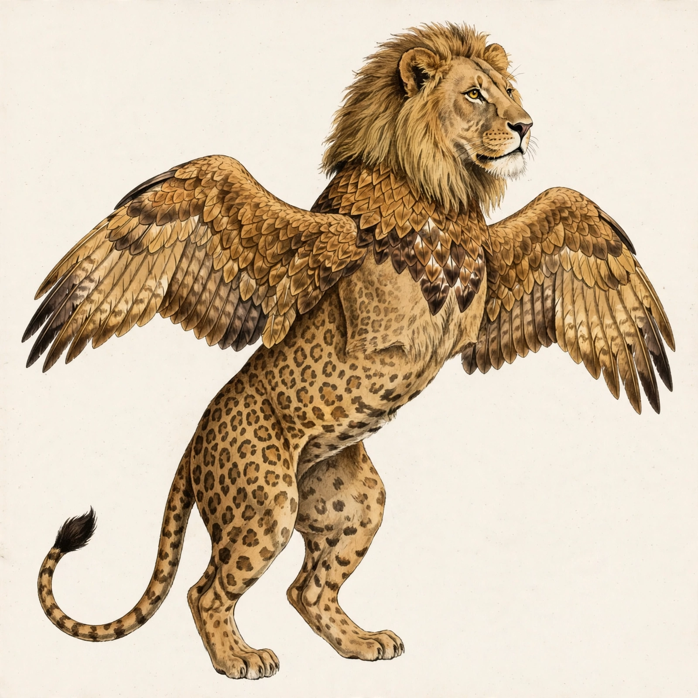
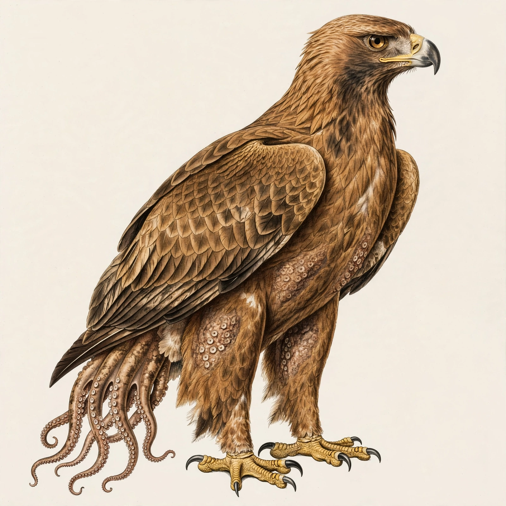
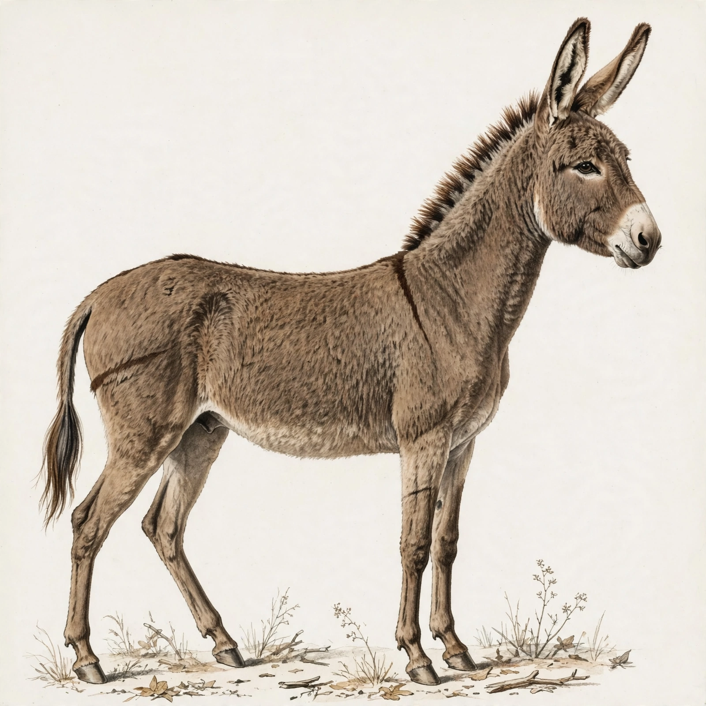
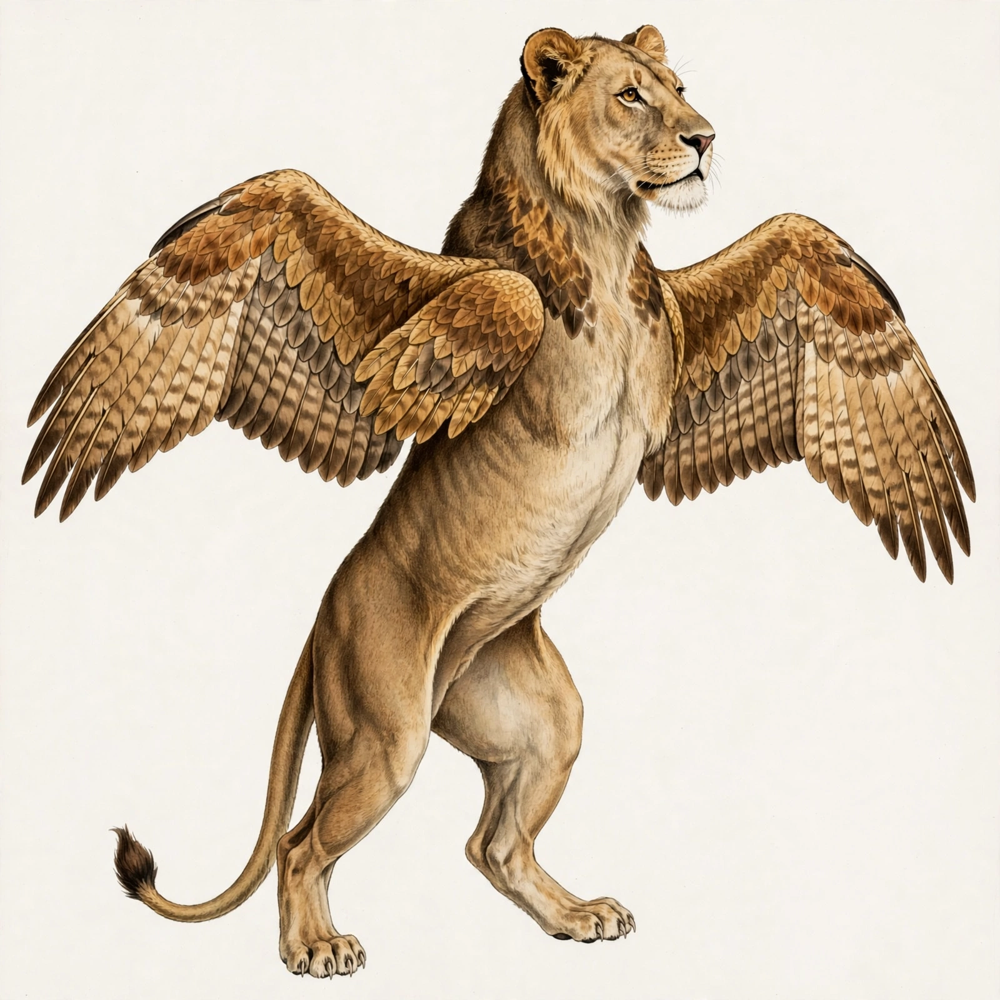
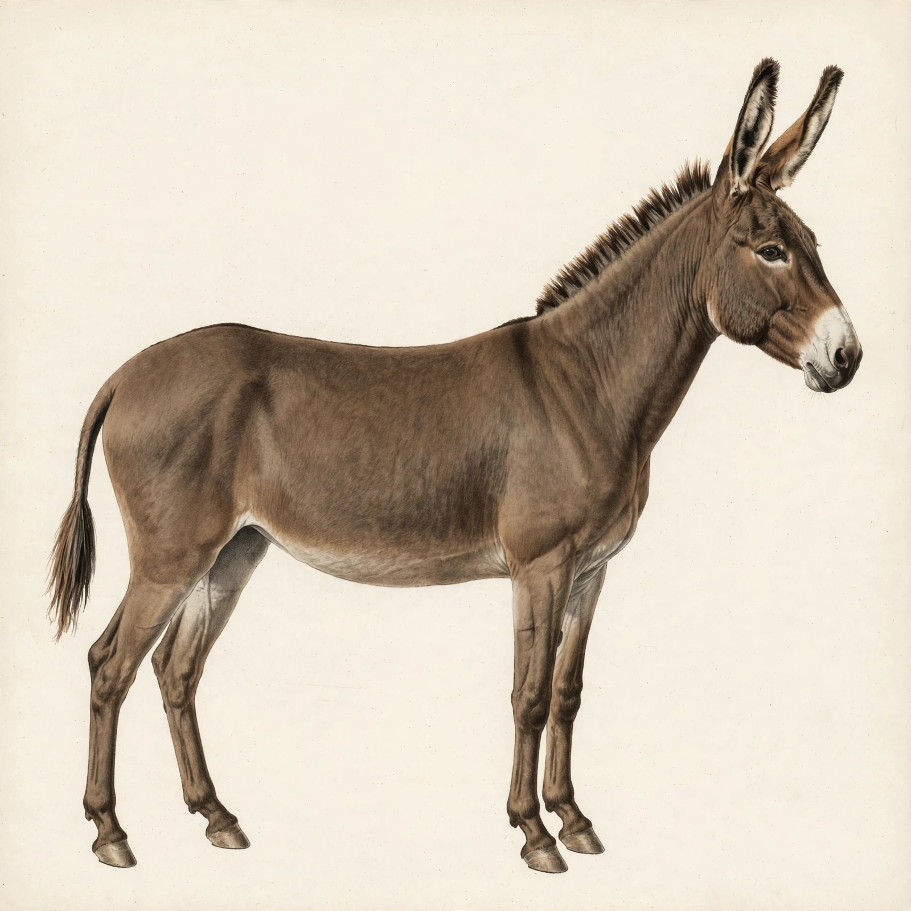

# E2-live: first live run of the evolution engine

Date: 2026-10-31. Branch: `evo`. The `evo` → `main` merge in step 0 was skipped, as the user asked.
Scope: the 4 worked examples only, `/fuse` code path, parents by name, seed 0, one image each. No evolve runs.
Outputs: `docs/evolution/live/e2/<example>/` contains `image.webp`, `plan.json`, `prompt_compiled.txt`,
`prompt_final.txt`, `critic.json` (critic answers, mask stats, scores), `sam_mask.png` and `calls.json`.
Totals are in `summary.json`. Key-free raw request/response pairs are in `raw/`.
Script: `scripts/e2_live_run.py`.

## The 4 images

| # | Image | Route | Host | Label | Quality | Critic (full image) | Critic (192 px thumbnail) |
|---|---|---|---|---|---|---|---|
| 1 |  | hybrid, known pair `mule` | horse | real hybrid precedent | **0.45** | named **donkey, zebra**; **1 creature**. "A donkey-like animal with faint zebra stripes stands in profile." | donkey; 1 creature |
| 2 |  | hybrid, known pair `liger` | lion | real hybrid precedent | **0.955** | named **lion, tiger**; **1 creature**. "A large tawny hybrid big cat with faint tiger stripes stands in profile." | lion, tiger; 1 creature |
| 3 |  | chimera | lion | speculative chimera, no real-world precedent; non-flying wings: display or gliding only | **0.768** | named **lion, leopard, eagle**; **1 creature**. "A mythical winged creature with a lion head and spotted feline body rears up." | lion, leopard, bird; 1 creature |
| 4 |  | chimera | golden eagle | speculative chimera, no real-world precedent | **0.70** | named **eagle, octopus**; **1 creature**. "A large brown eagle with octopus tentacles growing from its lower body." | eagle, octopus; 1 creature |

Score parts (quality = 0.4 critic + 0.3 silhouette + 0.1 thumbnail + 0.2 (1 − soft penalty)):

| # | critic | silhouette | thumbnail | soft penalty | SAM prompt | SAM mask (fill, aspect, components) |
|---|---|---|---|---|---|---|
| 1 | 0.5 | **0.0** | 0.5 | 0.0 | "horse" | **empty** |
| 2 | 1.0 | 0.96 | 1.0 | 0.167 (RC-R1-11) | "lion" | 0.333, 1.16, 1 |
| 3 | 1.0 | 0.392 | 0.5 | 0.0 | "lion" | 0.364, 0.98, **2** |
| 4 | 1.0 | **0.0** | 1.0 | 0.0 | "golden eagle" | **empty** |

First plan from Muse Spark: accepted for examples 2, 3 and 4. For example 1 it was **rejected and the code skeleton was used**: the model edited a locked mule-override field (the `body` trait), which is blocked by RC-R2-03. Prompt polish changed the wording in all 4 prompts, and `accept_polish` kept all 4.

## My judgment: does each image match its plan?

1. **Donkey x horse (mule): no, only partly.** The donkey head and long ears are right, but the body reads as a donkey, not a horse-height horse frame. The "faint donkey pattern at 50 percent" came out as bold zebra-like stripes, so the critic named a zebra.
2. **Lion x tiger (liger): yes.** A large, long, tawny cat with faint stripes on the flanks and legs and almost no mane, as planned.
3. **Lion x eagle: partly.** Eagle wings in place of the forelegs, standing on the hind legs, with feather patches on the chest and neck, as planned. But it has a full lion mane, which the plan gated off, and leopard spots that come from the habitat cue ("more patterned, irregular coat markings").
4. **Eagle x octopus: yes.** A golden eagle frame with jointless tentacles in place of the tail, and octopus skin with suckers in patches on the flanks and thighs.

## Calls: predicted vs made

| | Spark | Image | SAM |
|---|---|---|---|
| Predicted per example (first plan, polish, critic, thumbnail critic / render / segment) | 4 | 1 | 1 |
| Predicted, 4 examples | 16 | 4 | 4 |
| Made in step 4, every attempt counted (`calls.json`, `LIVE_LOG.md`) | **16** | **4** | **4** |
| Retries | 0 | 0 | 0 |
| Step 3 SAM probe | 0 | 0 | 1 |
| **E2 total** | **16** | **4** | **5** |

No call failed, so the retry policy never fired. Latency per call: plan 14 to 34 s, polish 11 to 24 s, render 22 to 33 s, critic 4 to 10 s, SAM 1.1 to 4.4 s. Decoding each SAM mask locally adds a few seconds of pure-Python work.

## Budget counter (`docs/live/budget.json`, shared with L1)

| | image | spark | sam |
|---|---|---|---|
| Before E2 | 11 | 27 | 0 |
| After the step 3 probe | 11 | 27 | 1 |
| After step 4 | **15** | **43** | **5** |
| Caps for this run | 20 | 70 | 8 |

## Failures and what I did

- **No example failed**, so the "fail twice, skip" rule was never used.
- **Step 3, SAM mask format.** SAM 3.1 answered on the first call (`status: completed`, no `model_not_found` or auth error). Masks do not come back as an image. They come back as special-token text, `<|box;x1..y2;w;h|><|mask;x;y;data=H,W,~payload|>`. The payload is a box-local raster in base85, and `~` marks the "lossless" encoding, which is arithmetic-coded, so base85 plus zlib does not decode it. Meta publishes the decoder as `meta-sam-parser` (PyPI, author Meta Platforms, SAM License; the license forbids reverse engineering). Auto mode blocked the install, so I asked, and the user approved it. It is pinned at `meta-sam-parser==0.1.0` in `backend/requirements.txt`. `parse_sam_response` pastes every mask record into a full-frame binary PNG. Checked by eye: the probe mask covers the donkey exactly, including the ears, tail and legs. The recording is `backend/tests/fixtures/recorded/sam-01.json` (image `docs/live/fusions/horse_donkey.webp`, prompt "animal").
- **Empty SAM masks (examples 1 and 4).** The judge prompts SAM with the host's common name. "horse" on an image that reads as a donkey, and "golden eagle", both returned an empty message, so the silhouette score was 0. That cost 0.3 quality on both. The probe prompt "animal" worked. I did not change the judge or re-run anything: it would cost 2 more SAM calls, and the task says not to loop. **Suggested fix:** prompt SAM with "animal" (or "creature") and keep the host name only for the aspect band.
- **Silhouette calibration.** A correct standing donkey (the probe) has a mask aspect of 0.96, because the ears and neck are tall. That is below the quadruped band of 1.2 to 2.6, so it scores about 0.76. The lion x eagle mask splits into 2 components (wing tips and body), which halves its silhouette score although the critic saw 1 creature. Both are worth recalibrating before evolve relies on the silhouette score.
- **Contradictory model prose in a prompt (example 3).** The accepted model plan's trait notes say "limbs are four lion legs; no forelimb-to-wing substitution", while the limb plan says wings in place of the forelegs, and both reached the compiled prompt. The hard checks validate structure, not note text. The image followed the limb plan.
- **Habitat cue leaks into the coat.** "More patterned, irregular coat markings" (forest) became leopard spots in example 3, and the critic then named a leopard.

## Code changed in E2

- `route.py`: `LABEL_CLOSE` is now "speculative hybrid of close relatives, no documented cross".
- `chimera_data.json`: the guanaco is now *Lama guanicoe*. The cama override still resolves for both dams (D-055).
- `evolution/live.py`: live Muse Spark (first plan, polish, critic), SAM 3.1 (`sam-3.1`, Responses API, text plus data-URL image), and Muse Image through `call_with_retry`. All of them go through the existing `_MetaClient`: live budget guard before each attempt, a usage record after it, and key-free recordings.
- `adapters/usage.py`: new budget kind `sam` with cap `CHIMERA_LIVE_MAX_SAM`.
- `adapters/meta/client.py`: `raw=True` returns the HTTP body unparsed, and the upstream error body is now kept on errors.
- `engine.py`: in real mode the live adapters are built when `META_API_KEY` is set; without it, the engine still refuses before any call. If the first-plan call fails, the code skeleton is used (a budget error still stops the run).

Tests: backend 235 passed, 6 skipped (live, off by default). The 18 new tests include the SAM parser tested in mock mode against the recording.

---

# E2b: third-animal leakage fixed, examples 1 and 3 re-run live

Date: 2026-10-31. Branch: `evo` (not merged). Same caps: 20 images, 70 Spark and 8 SAM on the shared counter.
Outputs: `docs/evolution/live/e2b/`. Command: `scripts/e2_live_run.py e2b 1 3`.

## What changed (commit `679047a`)

1. **Prompt compiler.** A pattern is named only as "<donor>-type <type>" (for example "faint tiger-type stripes at about 20 percent strength on the flanks and legs"). The donor and type come from a new `coat_patterns` table in `data/evo_config.json`. If no parent carries a pattern, the prompt says "plain coat, no stripes or spots". The generic "Pattern lines ... follow the body outline" line now names the donor, or becomes "Coat texture flows along the body outline". Plan notes that mention patterns, or contradict the limb plan or mane, are left out of the prompt. That removes E2's "limbs are four lion legs; no forelimb-to-wing substitution".
2. **Mule and hinny.** Both overrides now carry an explicit plain `coat_pattern`. R2 documents no markings for either: RC-R2-03 covers coat *texture* only, and RC-R2-04 covers ears, mane, tail and size. The old donkey overlay came from the generic hybrid builder. That builder now overlays only a pattern a parent really has.
3. **Habitat step.** It now only scales the strength of an existing donor pattern: 0.1 fainter in open habitats, 0.1 bolder in closed ones. Its wording names the pattern ("fainter tiger-type stripes for an open habitat"). With no patterned parent it changes nothing, and it never adds markings. The old cue "more patterned, irregular coat markings" is gone; in E2 it produced example 3's leopard spots.
4. **Polish.** The polish is rejected if it adds an animal name that is not a parent (any of the 200 data animals, or their head word such as "leopard"). It is also rejected if it contradicts the limb plan or mane, or adds bare pattern wording. The compiled prompt is used instead, and the reason is stored in the creature's `polish` field.
5. **Critic.** If the full-image critic names an animal that is neither parent, the candidate is marked "third animal". Group words for a parent ("bird", "big cat") and the known pair's own name ("mule") do not count. It is then re-rendered once with the compiled prompt. If the third animal is still there, the creature is kept with a warning. The first image is kept as well.
6. **SAM scorer.** SAM is now prompted with "animal". A mask in 2 or more pieces is scored as one creature when the critic says one.
- **Also changed:**
  - `finish()` re-runs GATE, so a model plan cannot restore a mane that GATE removed. In E2 the accepted model plan put a lion mane back on a feathered neck.
  - The RC-R2-03 field-by-field check now ignores `None` values on both sides.
- **Tests:** 268 new tests in `tests/evolution/test_e2b_leakage.py`, including a 240-pair sweep. Backend total: 503 passed, 6 skipped.

## Before and after

| # | Image | Route | Host | Label | Quality | Critic (full image) | Critic (192 px thumbnail) |
|---|---|---|---|---|---|---|---|
| 1 before (E2) |  | hybrid, known pair `mule` | horse | real hybrid precedent | 0.45 | named **donkey, zebra**; **1 creature** | donkey; 1 creature |
| 1 after (E2b) |  | hybrid, known pair `mule` | horse | real hybrid precedent | **0.67** | named **donkey**; **1 creature**. "A brown donkey stands in profile against a light background." | donkey; 1 creature |
| 3 before (E2) |  | chimera | lion | speculative chimera, no real-world precedent; non-flying wings: display or gliding only | 0.768 | named **lion, leopard, eagle**; **1 creature** | lion, leopard, bird; 1 creature |
| 3 after (E2b) |  | chimera | lion | speculative chimera, no real-world precedent; non-flying wings: display or gliding only | **0.94** | named **lion, eagle**; **1 creature**. "A winged lion-like creature stands with outstretched feathered wings." | lion, eagle; 1 creature |

Score parts:

| # | critic | silhouette | thumbnail | soft penalty | SAM prompt | SAM mask (fill, aspect, components) | third animal | polish | re-render |
|---|---|---|---|---|---|---|---|---|---|
| 1 before | 0.5 | 0.0 | 0.5 | 0.0 | "horse" | empty | (not checked) | accepted | no |
| 1 after | 0.5 | 0.733 | 0.5 | 0.0 | "animal" | 0.284, 0.93, 1 | none | accepted | no |
| 3 before | 1.0 | 0.392 | 0.5 | 0.0 | "lion" | 0.364, 0.98, 2 (halved) | (not checked) | accepted | no |
| 3 after | 1.0 | 0.80 | 1.0 | 0.0 | "animal" | 0.354, 1.00, 2 (counted as one) | none | accepted | no |

The first plan for example 1 was again rejected under RC-R2-03, because the model edited the locked mule `body` field, so the code skeleton was used. Example 3's model plan was accepted. Its `coat_pattern` note ("eagle-pattern blocks") was left out of the prompt by fix 1.

## My judgment: does each image match its plan?

1. **Donkey x horse (mule): better, not yet.** The zebra stripes are gone (plain coat, as planned), and the critic sees no third animal. But the animal still reads as a plain donkey: long ears and donkey proportions, not the horse-height body and neck the plan asks for. So the critic names only one parent. The leakage is fixed; the mule frame is a separate problem, probably in how strongly the prompt carries the horse body.
2. **Lion x eagle: yes.** Eagle wings in place of the forelegs, standing on the hind legs, eagle feathers on the chest and neck, a plain lion coat elsewhere, and no mane, which matches GATE (feathered neck). No spots and no third animal.

## Calls: predicted vs made

| | Spark | Image | SAM |
|---|---|---|---|
| Predicted, 2 examples, no re-render | 8 | 2 | 2 |
| Extra if a re-render fires (per example) | +2 | +1 | +1 |
| Made, every attempt counted | **8** | **2** | **2** |
| Retries | 0 | 0 | 0 |
| Re-renders | 0 | 0 | 0 |

## Budget counter (`docs/live/budget.json`)

| | image | spark | sam |
|---|---|---|---|
| Before E2b | 15 | 43 | 5 |
| After E2b | **17** | **51** | **7** |
| Caps | 20 | 70 | 8 |

## Failures

None. Both examples succeeded on the first try. No re-render was needed, so the re-render path (tested in mock mode) did not run live. Remaining headroom on these caps is 3 images, 19 Spark and 1 SAM. That is not enough for another run with a possible re-render without raising the SAM cap.

---

# E2c: real-hybrid prompt, example 1 re-run live

Date: 2026-10-31. Branch: `evo` (not merged). Caps: 20 images and 70 Spark (unchanged), SAM raised from 8 to 15, all on the shared counter.
Outputs: `docs/evolution/live/e2c/`. Command: `scripts/e2_live_run.py e2c 1`.

## What changed (commit `0663718`)

1. **Real-hybrid prompt.** A real hybrid is a known pair, or a cross documented in `chimera_data.json` (`route.is_real_hybrid`). Its prompt is built by `prompt.compile_real_hybrid`:
   - It opens with the name and the cross: "A mule (donkey sire x horse mare), a real hybrid animal."
   - It describes the frame in host terms first and in full: "Horse-sized body, deep chest, long back, long neck, horse proportions".
   - It names the donor once, in one grouped clause: "with the donkey's long ears, short thick head, short upright mane, thin legs, small hooves and tufted tail".
   - It then gives the coat pattern clause from E2b, here "plain coat, no stripes or spots".
   - There are no "Silhouette:", "Host frame" or per-detail "Details:" lines, so the donor's name no longer comes back in every detail line. The wording lives in a new `prompt` block on each of the 7 known pairs in `data/evo_known_pairs.json`.
   - The liger prompt opens with "A liger (lion sire x tiger dam), a real hybrid animal. Very large cat body ...". It names the tiger once, in "faint tiger-type stripes".
   - Chimeras, mythic designs and close relatives with no documented cross keep the E2b prompt.
2. **No habitat step for real hybrids (D-056).** `finish()` calls `clear_habitat`: earlier habitat deltas are undone, and the plan carries no adjustments and no visible habitat cue. RC-R4-11 is not traced or penalised for these plans. The liger's stripes therefore stay at 30 percent in every habitat.
3. **Critic.** On the real-hybrid route only, naming the hybrid or an alias ("mule", "liger", "pizzly") counts as naming both parents. Such a name is never a third animal. On other routes "liger" still scores 0 and counts as a third animal.
4. **SAM cap 15.** `CHIMERA_LIVE_MAX_SAM` now defaults to 15 in `adapters/usage.py` and in the run script. The image and Spark caps are unchanged.
- **Tests:** 40 new tests in `tests/evolution/test_e2c_real_hybrid.py`, covering every known pair and both orders where allowed. Three earlier tests were updated: the liger habitat test now uses tiger x leopard, and the worked-examples test checks for the new opener on known pairs. Backend total: 543 passed, 6 skipped.

## Before and after

| # | Image | Route | Host | Label | Quality | Critic (full image) | Critic (192 px thumbnail) |
|---|---|---|---|---|---|---|---|
| 1 E2 |  | hybrid, known pair `mule` | horse | real hybrid precedent | 0.45 | donkey, zebra; 1 creature | donkey; 1 creature |
| 1 before (E2b) |  | hybrid, known pair `mule` | horse | real hybrid precedent | 0.67 | donkey; 1 creature | donkey; 1 creature |
| 1 after (E2c) |  | hybrid, known pair `mule` | horse | real hybrid precedent | **0.685** | named **donkey**; **1 creature**. "A brown donkey stands in profile against a plain background." | donkey; 1 creature |

Score parts:

| # | critic | silhouette | thumbnail | soft penalty | SAM mask (fill, aspect, components) | habitat cue | polish | re-render |
|---|---|---|---|---|---|---|---|---|
| 1 before (E2b) | 0.5 | 0.733 | 0.5 | 0.0 | 0.284, 0.93, 1 | "Habitat cue (dry woodland): larger ears and longer tail for shedding heat", which pushed toward donkey ears | accepted | no |
| 1 after (E2c) | 0.5 | 0.782 | 0.5 | 0.0 | 0.272, 0.98, 1 | none | accepted (wording only) | no |

The first plan was again rejected under RC-R2-03, because the model edited the locked mule `body` note, so the code skeleton was used. That does not affect the prompt, which is compiled from the locked override. Spark's polish changed only the punctuation ("with deep chest ... and horse proportions") and was accepted.

## My judgment: does the image match its plan?

**Closer, but the critic still says donkey.** Compared with E2b, the body is taller and deeper-chested, the neck and legs are longer and the back is longer. The coat is finer and plain, with no dorsal or shoulder stripe, and the ground scrub from the habitat cue is gone. The long ears, short upright mane, small hooves and tufted tail are as planned. So the frame moved towards the horse and the image is now a fair mule. The muzzle and head, though, are still a donkey's, and mules do look like big donkeys. The image-only critic, which has no plan to go on, names it "donkey", so the critic and thumbnail scores stay at 0.5. The quality gain (0.67 → 0.685) comes only from the silhouette (aspect 0.93 → 0.98). The E2c critic rule would score a "mule" answer as both parents, but this critic never said "mule".

## Calls: predicted vs made

| | Spark | Image | SAM |
|---|---|---|---|
| Predicted, 1 example, no re-render | 4 | 1 | 1 |
| Extra if a re-render fires | +2 | +1 | +1 |
| Made, every attempt counted | **4** | **1** | **1** |
| Retries | 0 | 0 | 0 |
| Re-renders | 0 | 0 | 0 |

## Budget counter (`docs/live/budget.json`)

| | image | spark | sam |
|---|---|---|---|
| Before E2c | 17 | 51 | 7 |
| After E2c | **18** | **55** | **8** |
| Caps | 20 | 70 | **15** |

## Failures

None. Example 1 succeeded on the first try with no re-render. Remaining headroom: 2 images, 15 Spark and 7 SAM.

---

# E2d: feature-checklist critic on the real-hybrid route (re-score only, no new images)

Date: 2026-10-31. Branch: `evo` (not merged). Caps: images 20, Spark 70, SAM 15 on the shared counter.
Outputs: `docs/evolution/live/e2d/`. Command: `scripts/e2d_rescore.py`.

## What changed (commit `756056c`)

1. **Checklists.** Each of the 7 known pairs in `data/evo_known_pairs.json` now has a `checklist` of 4 to 6 visible features, taken from its R2 card(s):

   | Pair | R2 card(s) | Checklist |
   |---|---|---|
   | mule | RC-R2-03 | horse-sized body and long legs relative to the head; long donkey ears; short upright mane; tufted, short-haired tail base; plain coat with no stripes |
   | hinny | RC-R2-04 | equine body close to a mule's but smaller and more horse-like; shorter, horse-shaped ears; fuller mane; fuller tail |
   | liger | RC-R2-05, RC-R2-08 | very large cat, longer and heavier-looking than a lion or a tiger; tawny, lion-like coat; faint tiger stripes; reduced mane or no mane; not a full mane together with full-strength stripes |
   | tigon | RC-R2-05, RC-R2-08 | cat near lion or tiger size, not oversized; tawny, lion-like coat; faint tiger stripes; reduced mane or no mane |
   | zebroid | RC-R2-07, RC-R2-09 | horse or donkey body shape, not a zebra's; base coat color of the non-zebra parent; partial stripes, not a full zebra coat; stripes strongest on the legs; stripes on parts of the neck and body |
   | hybrid bear | RC-R2-10 | long, polar-bear-like neck; small grizzly-like shoulder hump; visible tail; mostly pale coat; partly furred soles |
   | cama | RC-R2-13, RC-R2-14 | intermediate camelid body, not a patchwork of parts; no hump; short camel-like ears; long camel-like tail; split, llama-like hooves |

   The mule's "plain coat with no stripes" comes from the plain-coat override (E2b), not from the RC-R2-03 card text, as specified in the task.

2. **Critic, real-hybrid route only.** One Muse Spark call (purpose `evo_checklist`) sends the image and the numbered checklist, and asks for JSON:
   - one answer per item: `yes`, `no` or `unclear`;
   - a forced `choice` between sire, dam, the hybrid's name and "other";
   - a short note.

   The critic score is the mean of the answers, with yes = 1, unclear = 0.5 and no = 0. The forced choice is stored in `judge.forced_choice` and is not scored. Answers are matched to items by order, and a missing or invalid answer becomes "unclear". The schema has no `minItems`/`maxItems`, because a strict schema might reject them. The checklist route asks for no creature count, so the silhouette check halves a mask that comes back in pieces. The third-animal re-render does not apply on this route.
3. **Thumbnail critic.** It uses the same checklist and choices on the 192 px copy. The call count is unchanged: 2 Spark critic calls per render.
4. **Other routes.** The chimera, mythic and same-genus routes keep the open critic exactly as before (`critic_mode: "open"`). A documented cross with no known-pair entry has no checklist, so it also keeps the open critic.
- **Tests:** `tests/evolution/test_e2d_checklist.py` adds 19 tests covering the data, scoring, the choices, the request and parser, the metered client, engine wiring for full image and thumbnail, the open critic on other routes, and an unscored "other" choice. Two older tests that scripted the open critic on the mule were moved: one to a chimera, one to a prompt-only check. Backend total: 562 passed, 6 skipped.

## Re-score results

The silhouette and soft-penalty values are reused from each image's original run. Only the critic and thumbnail parts are new.

| Image | Before: open critic (full / thumbnail) | Forced choice (full / thumbnail) | Critic | Thumbnail | Quality |
|---|---|---|---|---|---|
|  E2c mule | "donkey" / "donkey" → 0.5 / 0.5 | **mule** / donkey | 0.5 → **0.8** | 0.5 → **0.8** | 0.685 → **0.835** |
|  E2 liger (check) | "lion, tiger" / "lion, tiger" → 1.0 / 1.0 | **liger** / **liger** | 1.0 → 1.0 | 1.0 → 0.9 | 0.955 → 0.945 |

Per-item answers, mule (E2c image):

| Item | Full image | Thumbnail |
|---|---|---|
| horse-sized body and long legs relative to the head | yes | **no** |
| long donkey ears | yes | yes |
| short upright mane | yes | yes |
| tufted, short-haired tail base | yes | yes |
| plain coat with no stripes | **no** | yes |
| Score | 4/5 = 0.8 | 4/5 = 0.8 |
| Note | "Horse-proportioned body with long donkey ears, upright mane, and tufted tail indicates a mule." | "The illustration shows classic donkey features in profile." |

Per-item answers, liger (E2 image):

| Item | Full image | Thumbnail |
|---|---|---|
| very large cat, longer and heavier-looking than a lion or a tiger | yes | unclear |
| tawny, lion-like coat | yes | yes |
| faint tiger stripes | yes | yes |
| reduced mane or no mane | yes | yes |
| not a full mane together with full-strength stripes | yes | yes |
| Score | 5/5 = 1.0 | 4.5/5 = 0.9 |
| Note | "Large tawny cat with faint striping and only a slight ruff matches a liger." | "Tawny coat with faint leg stripes and reduced mane matches liger." |

## My judgment

- **Mule: the checklist reads the image better than the open critic did.** On the full image, given the hybrid's name as an option, the critic picks "mule", and its note names the horse-proportioned body. The open critic's "donkey" was an image with no context matched to the nearest common animal; the image itself did not change. Two answers are doubtful. The full image's "no" on "plain coat with no stripes" is one: I see no stripes, only darker shading on the shoulder and knees, which the critic may have read as markings. The thumbnail's "no" on the horse-sized body is the other, since size and proportion are hard to judge at 192 px, where the critic also chose "donkey". Full image and thumbnail disagree on exactly those two items, so single answers are noisy even at temperature 0.
- **Liger: consistent.** All five items are yes on the full image, and the forced choice is "liger" on both sizes. The only drop is "very large" being unclear at thumbnail size, which is fair: absolute size can't be seen without a scale reference. So the checklist does not inflate a correct image, and its score is close to the open critic's.

## Calls: predicted vs made

| | Spark | Image | SAM |
|---|---|---|---|
| Predicted (2 images x full and thumbnail) | 4 | 0 | 0 |
| Made, every attempt counted | **4** | **0** | **0** |
| Retries / failures | 0 / 0 | - | - |

## Budget counter (`docs/live/budget.json`)

| | image | spark | sam |
|---|---|---|---|
| Before E2d | 18 | 55 | 8 |
| After E2d | **18** | **59** | **8** |
| Caps | 20 | 70 | 15 |

## Failures

None. Remaining headroom: 2 images, 11 Spark, 7 SAM.
