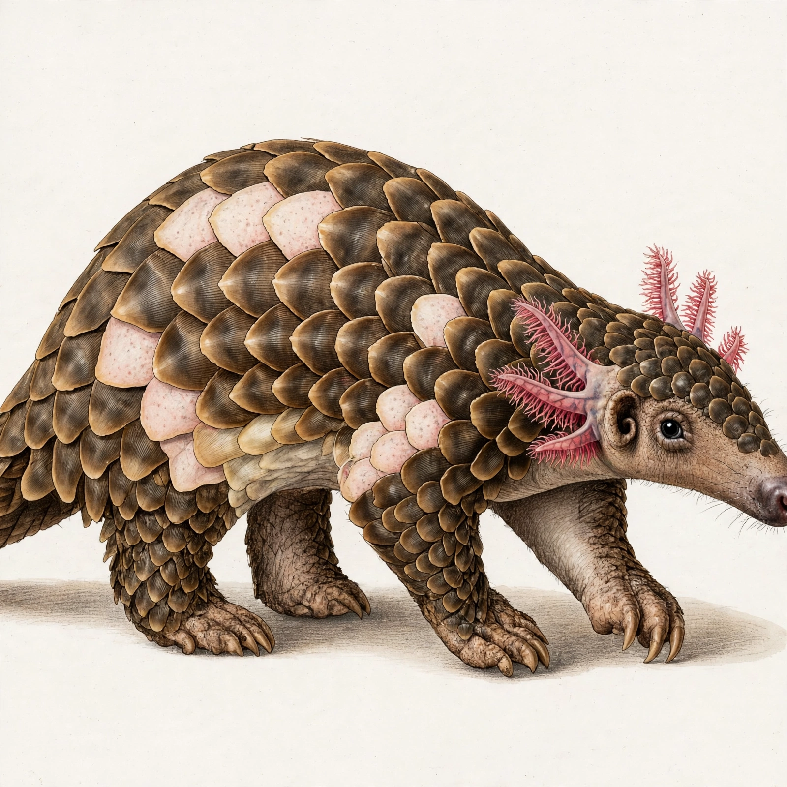
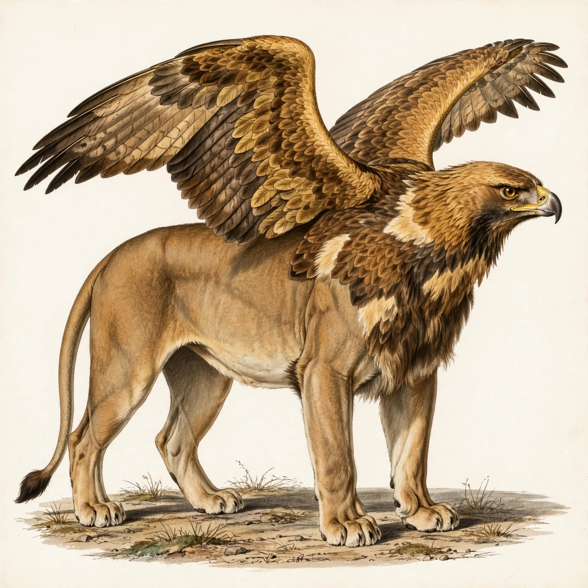
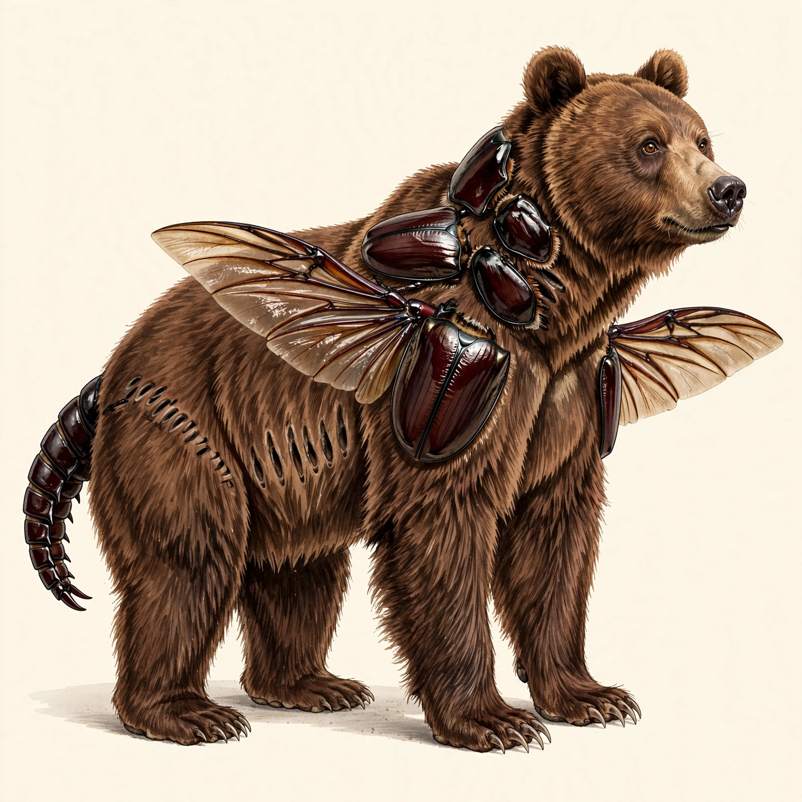

# E4: open-world engine, function audit and fiction budget (live check)

Date: 2026-10-31. Branch: `evo` (not merged). Spec: `docs/evolution/ALGORITHM.md` v2 and `docs/evolution/ENGINE_CONTRACT.md`.
Command: `scripts/e4_live.py` (outputs in `docs/evolution/live/e4/`). Caps: images 27, Spark 100, SAM 16 on the shared counter.

## What was built (steps 0 to 6)

| Step | Result | Commit |
|---|---|---|
| 0 | `verify_research.py` gate passed with R9 (10 files, 109 cards, 0 failures, 16 bot-blocked 403s). `data/rule_cards.json` regenerated: 109 cards, 17 hard. ALGORITHM v2: 4.5b function audit, 4.5c fiction budget, design modes, RC-R9-01 labels, section 8 tests. New ENGINE_CONTRACT.md. | `3ada791` |
| 1 | Resolver `evolution/resolve.py`: the database, then the learned cache, then the open world (Spark identifies, GBIF exact species match, Spark fills traits). Refusals; `needs_choice`; offline fallback. GBIF client with timeout, retry and recorded fixtures; `/evo/resolve`. | `137195d` |
| 2 | Routing for any pair by taxonomy distance; precedent comes only from data files; model claims stay "unverified claim"; label "mythic composite". A source scan found and removed two hard-coded names in `checks.py`. | `997f49c` |
| 3 | Function audit `evolution/audit.py`, six functions. Code decides where a card covers the case; one Spark call judges the rest. Hard checks RC-R9-01, 02, 03, 06, 09. | `b77cb4e` |
| 4 | Fiction budget `evolution/fiction.py`: realistic 0, speculative 1, mythic 3. Every license carries a compensation; over-budget needs are repaired, then labeled; honesty and floor rules are never licensable; compare mode; RC-R9-10. | `058ccbb` |
| 5 | The checklist critic, generated from the plan, runs on every route; the open critic is logged only. The card gains "Can it live?", licenses, kind and provenance. Every prompt gets the prosaic-detail line. | `b6ec5a9` |
| 6 | Full suite 684 passed, 6 skipped (122 new E4 tests). | `68b8753` |

## a) Resolver (no images)

| Input | Result | Kind | Taxonomy source | Traits source | Notes |
|---|---|---|---|---|---|
| axolotl | axolotl, *Ambystoma mexicanum* (Amphibia, Caudata, Ambystomatidae) | species | chimera_data.json | chimera_data.json (breathing "external gills and lungs" is project data) | database: 0 calls |
| golden retriever | Golden Retriever, *Canis lupus familiaris* (Mammalia, Carnivora, Canidae, Canis) | breed | gbif (EXACT, SUBSPECIES, key 6164210) | model-estimated | "a breed of Canis lupus familiaris: taxonomy from the species, look from the breed". Breed look kept: dense golden coat, feathered tail, floppy ears |
| woolly mammoth | woolly mammoth, *Mammuthus primigenius* (Mammalia, Proboscidea, Elephantidae) | extinct | gbif (EXACT, SPECIES, key 4825833) | model-estimated | Spark also claimed a documented cross with *Mammuthus columbi*. It is stored as "unverified claim" and routing never reads it |
| jaguar | jaguar, *Panthera onca* | species | chimera_data.json | chimera_data.json | database: 0 calls |
| pangolin | Chinese pangolin, *Manis pentadactyla* (Mammalia, Pholidota, Manidae, Manis) | ambiguous | chimera_data.json tier2 (gbif): no GBIF call | model-estimated | "'pangolin' names several species; chose the Chinese pangolin (Manis pentadactyla), the most common reading". Alternatives: Sunda, Indian, ground and white-bellied pangolins |

No input returned `needs_choice`: every species Spark named had an exact GBIF or tier2 match. That path is covered by mock tests on recorded GBIF FUZZY, NONE and genus-level responses. During d), "rhinoceros beetle" was also ambiguous; it resolved to the European rhinoceros beetle (*Oryctes nasicornis*, GBIF EXACT, key 4995700), with the Japanese, Hercules, coconut and Eastern Hercules beetles as alternatives. All four learned animals are in `data/learned_animals.json`, and the GBIF responses are in `live/e4/gbif/`.

## b) Axolotl x pangolin, realistic

- **Plan:**
  - Route: chimera, label "speculative chimera, no real-world precedent", distance beyond class.
  - Host: the Chinese pangolin, 4.5 kg; habitat: river forest (bridging freshwater and forest).
  - Axolotl contribution: skin patches over the back and flanks.
  - The model's first plan was accepted.
- **Audit (Can it live?):**

| Function | Result | Decided by | Cards | Detail |
|---|---|---|---|---|
| breathing | **repaired** | code | RC-R9-03, RC-R9-12 | The axolotl's external gills would collapse in air and have no job in a river-forest habitat, so they are dropped; the creature breathes with the pangolin's lungs. |
| feeding | pass | **model-judged** | - | Toothless tongue on an insectivore head; no card covers a toothless tongue. This was the one audit call. |
| support | pass | code | - | Legs match the body size. |
| movement | pass | code | - | Walks on four legs. |
| heat | pass | code | RC-R4-11 | Temperate river forest: no heat adjustment needed. |
| senses | pass | code | RC-R6-03, RC-R6-04 | Pangolin head and eyes kept visible. |

- **Licenses:** none (realistic budget 0).
- **Checklist (generated):** 4 items, all yes on both sizes: Chinese pangolin body shape; pangolin head with visible eyes; axolotl skin patches on the back and flanks; feet resting on the ground. Forced choice: "a mix of both" on both sizes. Open critic: "A scaly pangolin-like creature with pink feathery axolotl gills walks in profile."
- **Scores:** critic 1.0, silhouette 1.0 (fill 0.431, aspect 1.455, 1 piece), thumbnail 1.0, soft penalty 0 → **quality 1.0**.
- **Judgment: no.** It is a convincing pangolin with axolotl skin patches, but it has the axolotl gills the realistic audit dropped. The accepted model plan's notes ("axolotl gills attached externally", "with axolotl gills supplemental", "stays near water to keep gills moist") reached the prompt. The generated checklist had no item about gills, so the image scored 1.0. **Fixed after the run, in code only:** a dropped part is now recorded on the plan; note clauses that mention it are stripped and kept out of the prompt; and the checklist asks "no external gills". A regression test replays the live model's words. Not re-rendered.

## c) Lion x eagle, mythic

- **Plan:**
  - Route: mythic, kind "mythic composite".
  - Host: the lion, 199 kg, forest habitat.
  - The head is swapped to the eagle's, myth-style.
  - Four lion legs plus a separate pair of golden eagle wings, held for display or gliding (above 40 kg).
  - Eagle feather patches over the forequarters and neck.
  - Plan: the stored plan is identical to the code skeleton, so the model's plan was rejected or came back unchanged. The reason was not kept, because a cached document has no `model_plan` field.
- **Audit:** breathing pass (lungs); feeding pass (RC-R9-04 and RC-R9-05: a beak is never a reason to reject); support pass (RC-R9-06); **movement licensed** (RC-R3-02 with RC-R3-03, -04, RC-R9-13 and -10: six limbs, wings non-flying); heat pass; senses pass. All code-decided, so no audit call.
- **Licenses:** 1, **six limbs** (RC-R3-02), shown with "wings rooted in a heavy shoulder structure that can carry them, not floating". The labels include "six limbs: mythic composite, not a plausible animal" and "mythic composite with 1 declared license: believability drops with each extra license" (RC-R9-11).
- **Checklist (generated):** 5 items, all yes on both sizes: lion body shape; golden eagle head with visible eyes; wings rooted in a heavy shoulder structure; four legs plus a separate pair of golden eagle wings; eagle feather patches on the forequarters and neck. Forced choice: "a mix of both". Open critic: "A griffin with an eagle's head and wings and a lion's body stands in profile."
- **Scores:** critic 1.0, silhouette 0.873 (aspect 1.073 sits just below the quadruped band; mask in 3 pieces, counted as one creature because the critic saw one), thumbnail 1.0 → **quality 0.962**.
- **Judgment: yes.** Four legs plus wings growing from heavy shoulders, an eagle head with feathered forequarters, and the six-limb license declared and visible.

## d) Rhinoceros beetle x brown bear, speculative

- **Plan:**
  - Route: chimera, distance beyond class.
  - Host: the brown bear, 340 kg, grassland habitat.
  - The European rhinoceros beetle contributes exoskeleton patches over the forequarters and neck, and jointed tail segments in place of the tail.
  - Spark's traits list the beetle as `multi_legged|winged`, so it is a wing donor and its wings take the forelimb slot (RC-R3-01), labeled non-flying.
  - Plan: identical to the code skeleton.
- **Audit:** breathing pass (lungs, land); feeding pass (RC-R9-04, mixed teeth fit an omnivore); **support licensed** (RC-R3-09, RC-R9-08 and -10: arthropod parts at 340 kg, with "the oxygen explanation for giant insects is debated, not settled"); movement labeled (non-flying wings; jointed tail has a job, balance and defend); heat pass; senses pass. No audit call.
- **Licenses:** 1, **arthropod parts at large size** (RC-R3-09), shown with "thick supporting legs and visible breathing openings along the flanks". The honest label "speculative: arthropod parts at large size" stays.
- **Checklist (generated), full image / thumbnail:**
  - brown bear body shape: yes / yes
  - brown bear head with visible eyes: yes / yes
  - thick supporting legs and visible breathing openings along the flanks: yes / **no**
  - beetle wings in place of the front legs: **no / no**
  - beetle jointed tail segments: yes / yes
  - beetle exoskeleton patches on the forequarters and neck: yes / yes

  Forced choice: "a mix of both". Open critic: "A brown bear fused with beetle shells, wings, and a segmented tail."
- **Scores:** critic 0.833, silhouette 0.818 (mask in 7 pieces, counted as one creature because the critic saw one), thumbnail 0.667 → **quality 0.845**.
- **Judgment: partly.** One size license, and its compensation is visible as a row of breathing openings along the flank, but the legs are ordinary bear legs, not visibly thickened. The beetle wings were drawn in addition to four legs instead of in place of the forelegs. The checklist caught that with "no" on both sizes, but nothing acts on a failed item.

## Calls: predicted vs made

| | Spark predicted | Spark made | Image | SAM | GBIF |
|---|---|---|---|---|---|
| a) resolve 5 names (2 learned: identify plus traits) | 6 | 6 | 0 | 0 | 2 |
| b) plan, polish, audit, checklist x2, open critic | 6 | 6 | 1 | 1 | 0 |
| c) plan, polish, checklist x2, open critic | 5 | 5 | 1 | 1 | 0 |
| d) learn the beetle (2), plan, polish, checklist x2, open critic | 7 | 7 | 1 | 1 | 1 |
| **Total** | **24** (task estimate about 27) | **24** | **3** | **3** | **3** |

There were no retries and no third-animal re-renders; every Meta call succeeded on its first attempt.

**Script failure (mine, not the engine's):** in run 1, `e4_live.py` wrote `image.webp` before creating the output folder. All three renders had already succeeded, so the script's second tries were served from the engine's cache at no cost. The outputs were rebuilt with `e4_live.py --recover` (0 Meta and 0 GBIF calls). The SAM masks were decoded offline from the recordings. The model-plan outcomes were inferred by comparing the stored plans with the code skeleton, because recordings elide message content.

## Budget counter (`docs/live/budget.json`)

| | image | spark | sam |
|---|---|---|---|
| Before E4 | 18 | 59 | 8 |
| After E4 | **21** | **83** | **11** |
| Caps | 27 | 100 | 16 |

No cap was reached. Headroom: 6 images, 17 Spark, 5 SAM.

## What the engine still cannot handle

1. **Plan notes can bring a removed part back.** A model's plan notes can reintroduce a part that the audit or limb budget removed. This happened live in b). It is now fixed for parts that realistic mode drops. In general, the prompt filter knows only wings, legs, tentacles, mane, patterns and dropped parts.
2. **The render does not always follow a limb-slot change.** In d) the insect wings were drawn on top of four legs instead of replacing the forelegs. The judge sees it, but the pipeline does not act on a failed structural item: only a third animal triggers a re-render.
3. **The checklist checks what is planned, not what is absent.** b) scored 1.0 with an unplanned part present. "no" items now exist only for dropped parts.
4. **Learned traits are model-estimated and unchecked.** One Spark answer made the beetle `winged`, and that alone decided the plan's wings. GBIF confirms the taxonomy only.
5. **Some outputs say little.** The forced choice answered "a mix of both" on all six images. The open critic adds a second opinion but is not scored.
6. **Not run live:** photo input (mock only), `needs_choice` (mock fixtures only), compare mode, the GBIF-down fallback, and the 1 to 3 license budget beyond one license.
7. **`model_plan` is not kept with a cached creature.** A rejection reason is lost after a cache hit.

**Next weakest point:** the judge now detects structural misses, such as the limb slot in d) and absent parts in b), but nothing acts on them. A single re-render with the compiled prompt when a structural checklist item (frame, limbs, license compensation) is answered "no" would close the loop, as the third-animal check already does. It costs at most 3 Spark, 1 image and 1 SAM per creature.
