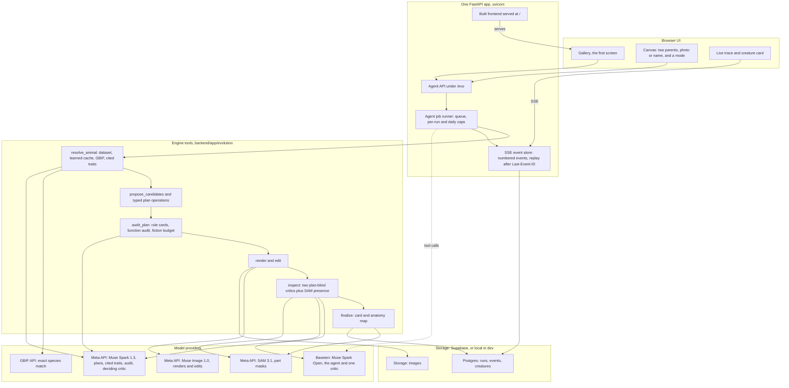
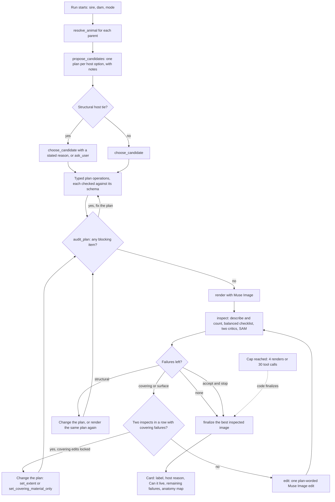

# Chimera Lab architecture

Two diagrams: the system as R1 builds it, and the agent loop. The engine and the agent loop exist and were run live
in S3c and S5. The browser UI, the agent API, the job runner and the event store are the R1 target described in
`docs/api_contract.md`; they were not merged at the time of writing (Nov 1, commit `990703e`). Hosting is not
decided (D-096), so the diagram shows one FastAPI app without a host.

## 1. System

What each part does, with its source:

| Part | What it does | Source |
|---|---|---|
| Browser UI | Gallery first; a run can be left and resumed; the trace shows every step | D-096, `docs/api_contract.md` |
| Agent API | `POST /evo/agent/runs`, run snapshot, SSE events, host-tie choice, limits, creatures, gallery | `docs/api_contract.md` |
| Job runner | Queues runs beyond 3 concurrent; refuses past 50 runs a day or 3 per visitor; finalizes the best image at 14 minutes, stops at 15 | `docs/api_contract.md`, "Caps" |
| Event store | Numbered events per run with no gaps, stored with the run, so a reconnect replays exactly | `docs/api_contract.md`, "Server-sent event schema" |
| Engine tools | The agent's tools, with guardrails in code | `backend/app/evolution/agent.py`, D-089 |
| Routing | Which provider serves each call type; a failed Baseten call falls back to Meta and is logged | `data/evo_config.json` `routing`, D-069 |
| Storage | Supabase when its credentials are set, else SQLite and local files. Supabase was not verified live | `backend/app/services.py`, v1 README |

Uploaded photos are identified, then discarded; only the names reach the job (`docs/api_contract.md`).

## 2. The agent loop

Muse Spark Open picks every step and gives a reason. The diamonds are checks code enforces.

Notes on the loop, each from the code or a decision:

- **The agent never writes a plan.** It adopts a candidate and applies typed operations. Code fills every derived
  field (D-067, D-089).
- **Audit before render** is checked by content: a plan changed after its audit must be audited again (D-089).
- **Structural failures cannot be edited away.** `edit` refuses them with `structural_failure`; they need a plan
  change and a new render (D-089).
- **Drift check:** after any edit, inspect compares the critics' head, leg and tail counts with the image before
  the edit and adds a `host_drift` failure if they changed (D-089).
- **The two-failure rule** locks covering edits on that plan's content; a plan change or a clean inspect resets it
  (D-091). Its second route, `set_covering_material_only`, keeps the host's own covering and takes only the donor's
  color, gloss, texture and pattern (D-092).
- **Finalize:** code ranks images by fewest structural failures, then fewest failures, then the latest. Choosing a
  lower-ranked image needs `why_not_best` (D-093).
- **Resumable:** images are kept on disk and runs are saved after every tool step (D-090).

## 3. The fixed pipeline, for comparison

`engine.fuse` (the S5 baseline) runs the same engine without the agent: Muse Spark 1.3 writes the plan, code audits
and compiles it, Muse Image renders once, inspect runs the same critics, and at most one edit turn follows. On a
structural host tie it has no rule and uses the first-named parent (D-085, `docs/evolution/S5_BENCHMARK.md`).
