# Before and after

The five most improved screens from the PV correction loop. Each pair is the same state captured by `npm run shots`. Left is pv-1, right is the corrected round.

## 1. Success: the creature leads (PV1-04, PV1-08)

| Before (pv-1) | After (pv-2) |
|---|---|
| 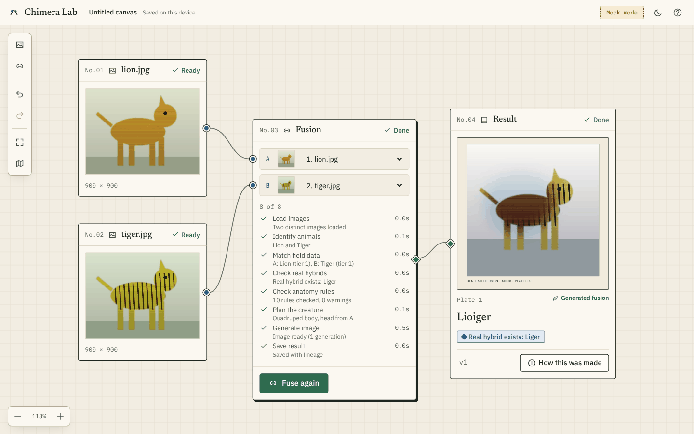 | 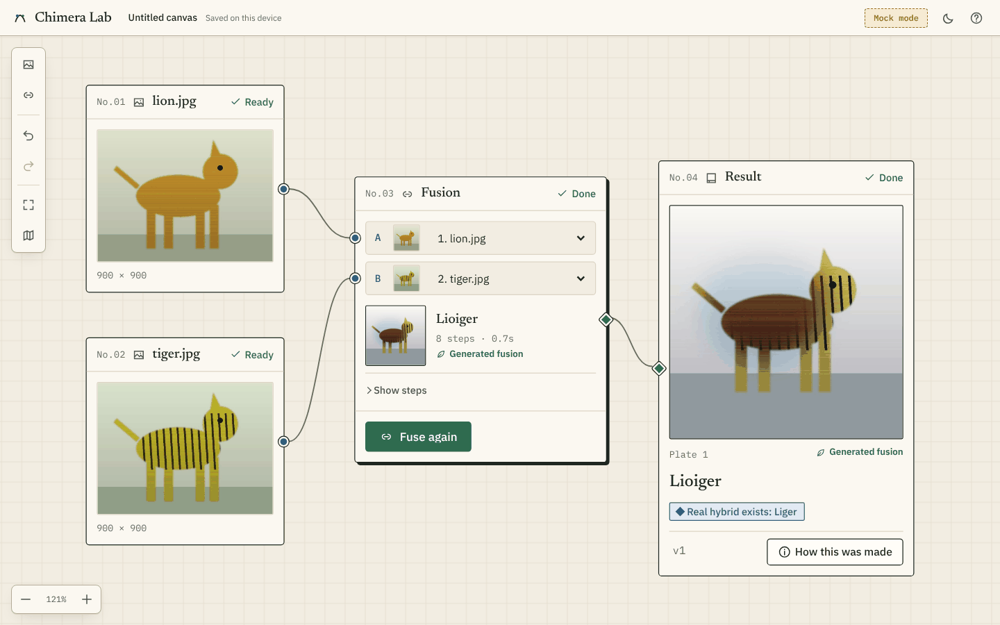 |

The Fusion node used to end in an 8-row step log with per-step details: taller and busier than the plate. It now folds into a summary (thumbnail, name, "8 steps · 0.7s", "Generated fusion") with a "Show steps" disclosure. The tasksheet's "result inside the Fusion node" requirement is also covered. The mock plate is now full-bleed, so the UI's frame and caption are the only frame.

## 2. Many nodes: no more stacking (PV1-01, PV2-02)

| Before (pv-1) | After (pv-3) |
|---|---|
| 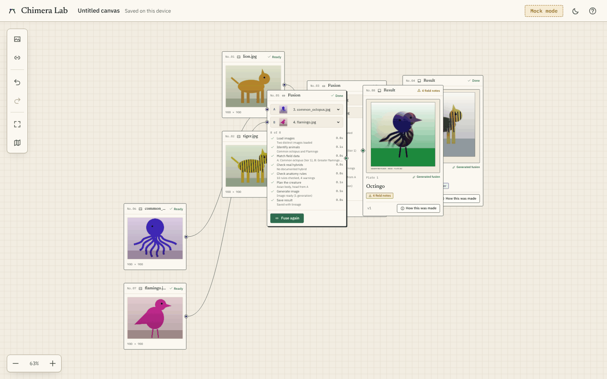 | 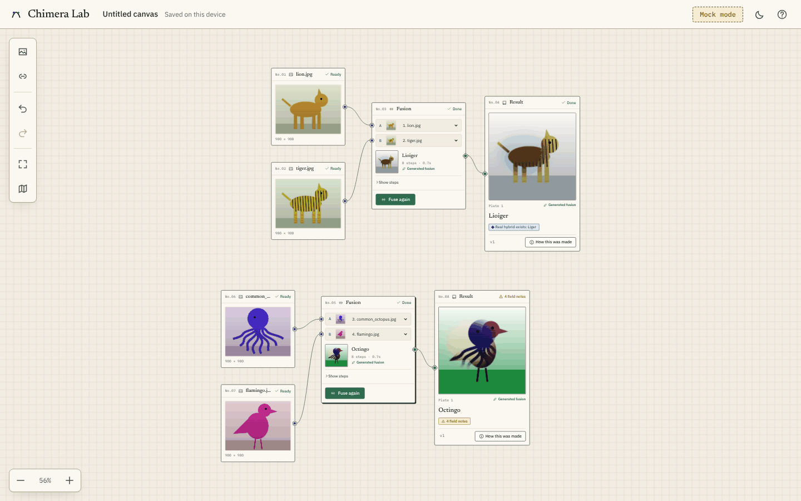 |

The second Fusion node and its Result landed on top of the first pair, leaving ports unreachable (blocker). New nodes now use free-space placement, and images added next to an empty Fusion node are wired into it and placed to its left, so the canvas reads as two clean rows.

## 3. Failed input: no layout shift (PV1-03)

| Before (pv-1) | After (pv-2) |
|---|---|
| 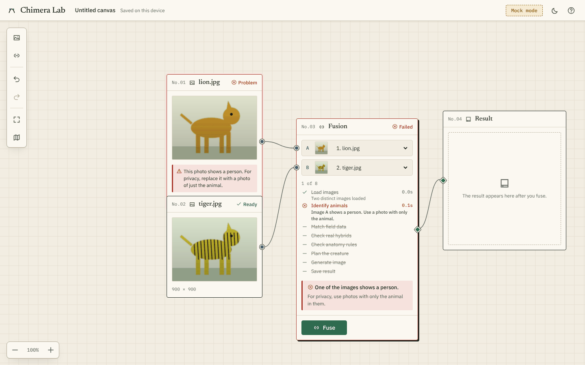 | 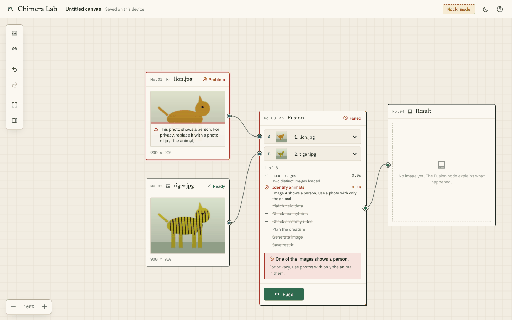 |

The flag note grew the Image node into its neighbour. Notes are now an overlay strip inside the image frame, with a cinnabar rule, so the card's height never changes.

## 4. Panel beside its node at 1024 (PV1-11)

| Before (pv-1) | After (pv-3) |
|---|---|
| 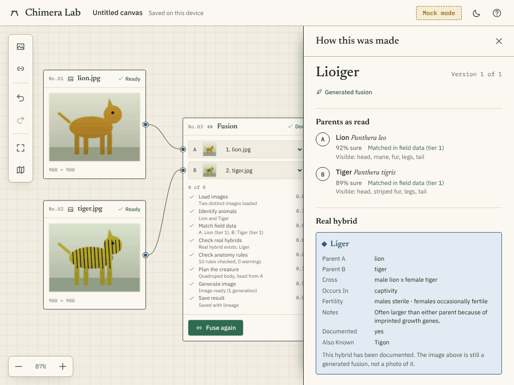 | 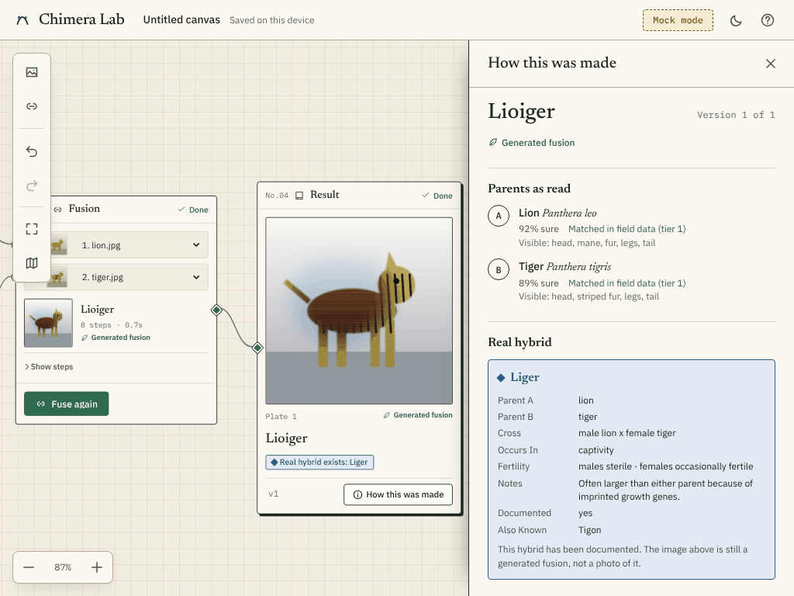 |

At narrower widths the drawer covered the very image it explains. Opening the panel now pans the canvas so the Result node sits fully to the left of it.

## 5. Offline add: new work is always in view (PV1-02, PV2-01)

| Before (pv-1) | After (pv-3) |
|---|---|
| 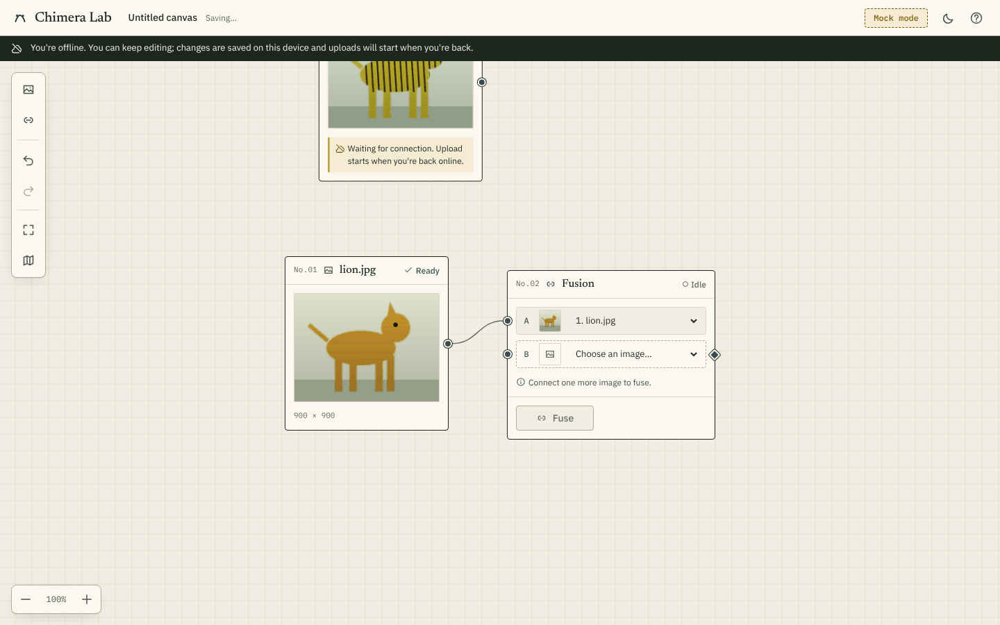 | 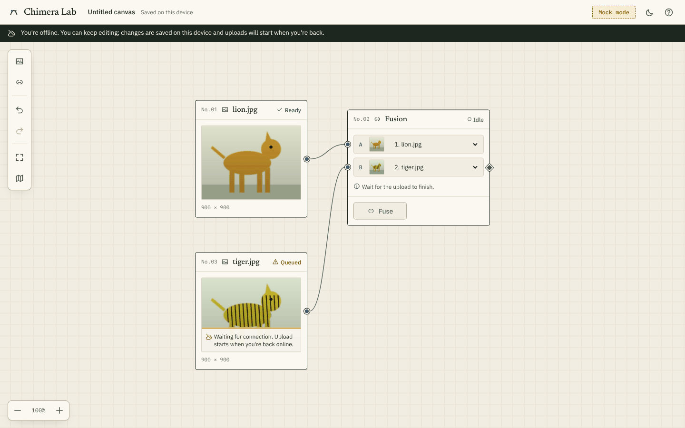 |

The queued image was dropped half above the viewport, and its note pushed the card taller. It is now placed right or down in free space, auto-wired to the free B input, and revealed (zooming out only if needed). The "Waiting for connection" note sits inside the frame.

# U1: Field paper → ZD

The same states before (pv-3, or f1 where pv-3 has no such screen) and after the U1 redesign. Both rounds come from `npm run shots`. Every image in the u1 shots is a real generated image: L1's live input photos and live fusions (D-052).

## U1-a. Canvas with a finished fusion

| Before (pv-3) | After (u1) |
|---|---|
|  | 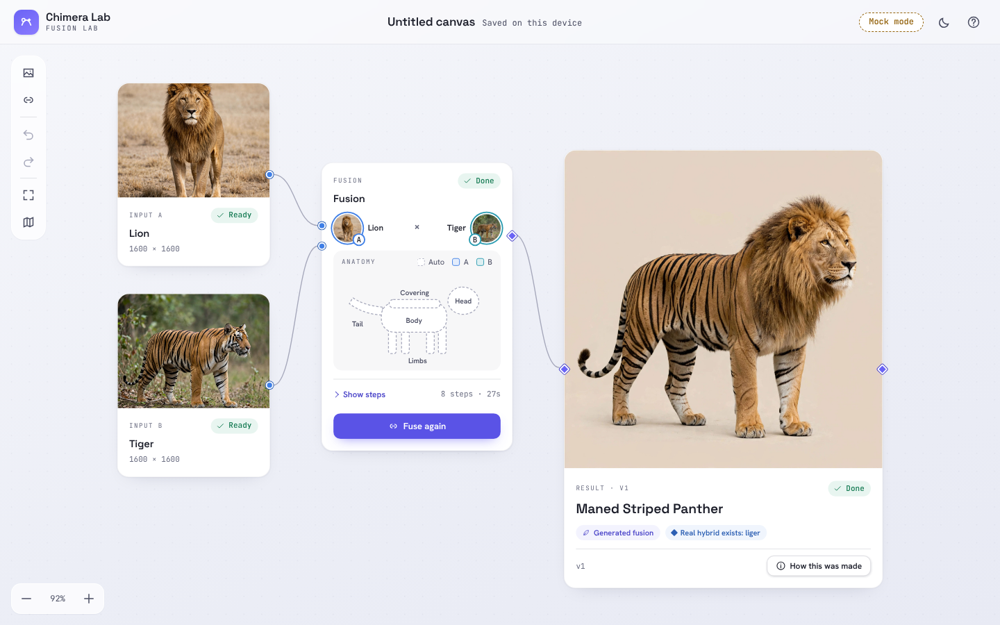 |

- **Before:** catalog-numbered specimen labels titled by filename, with a duplicate thumbnail in the Fusion node.
- **After:**
  - The photos are the nodes, titled by species ("Lion", "Tiger").
  - The Fusion node is two portraits, the body diagram and one primary action.
  - The Result card is the largest thing on the canvas.
  - Glass rail and zoom, a sparse dot grid, and the brand gradient only on the mark.

## U1-b. Result card

| Before (pv-3) | After (u1) |
|---|---|
| 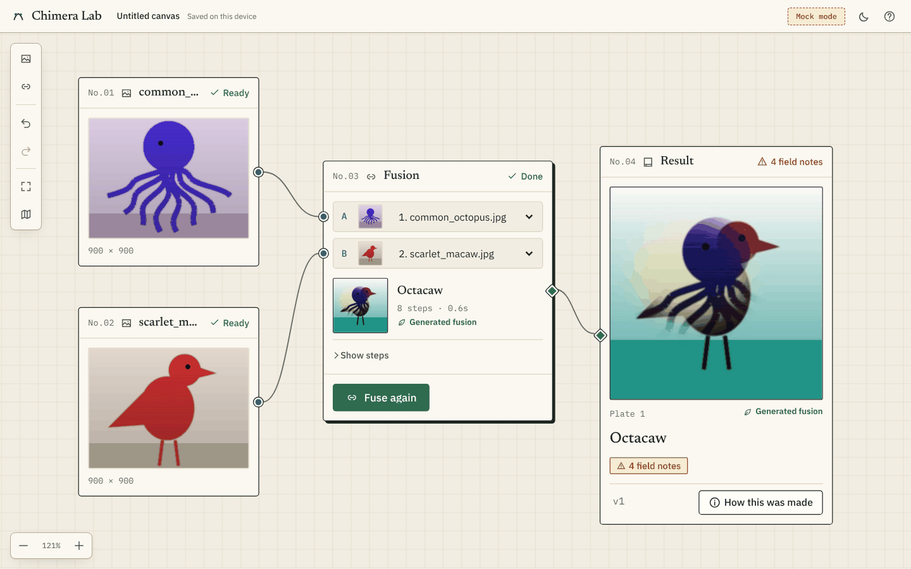 | 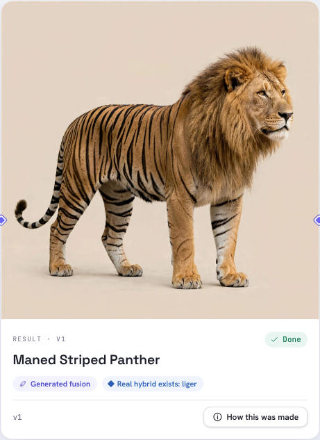 |

- **Before:** the plate was 304px wide inside a form-like card, with a "Plate 1" caption and outlined badges.
- **After:** a 500px hero card with:
  - the image edge to edge, clipped to the card radius
  - the creature's name in `--type-h2`
  - "Generated fusion" and real-hybrid pills
  - versions as SegmentedTabs
  - "How this was made" as the card's one action

## U1-c. Anatomy controls

| Before (f1; pv-3 predates F1) | After (u1) |
|---|---|
| 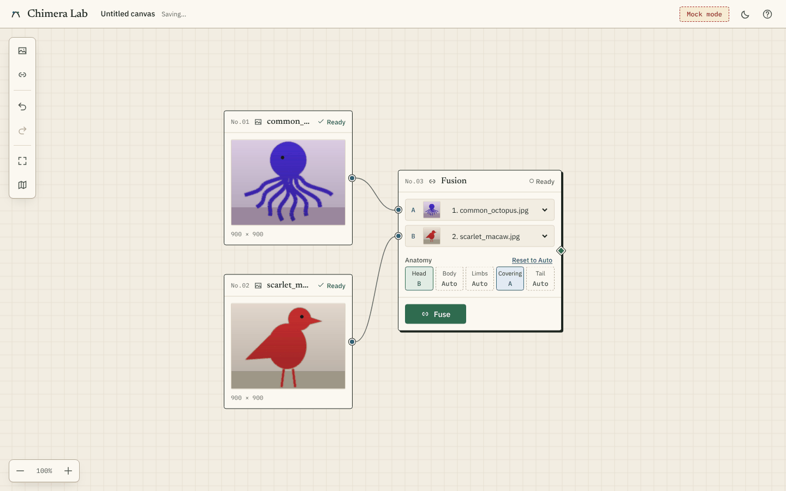 | 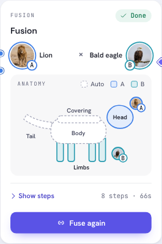 |

- **Before:** a row of five text toggles ("Head · B").
- **After:** a body diagram drawn from a region list. Pinned parts fill with the donor's colour and show the donor's portrait and letter; Auto parts stay dashed. Click, Enter or Space cycles each part.

## U1-d. Drawer: "How this was made"

| Before (pv-3) | After (u1) |
|---|---|
| 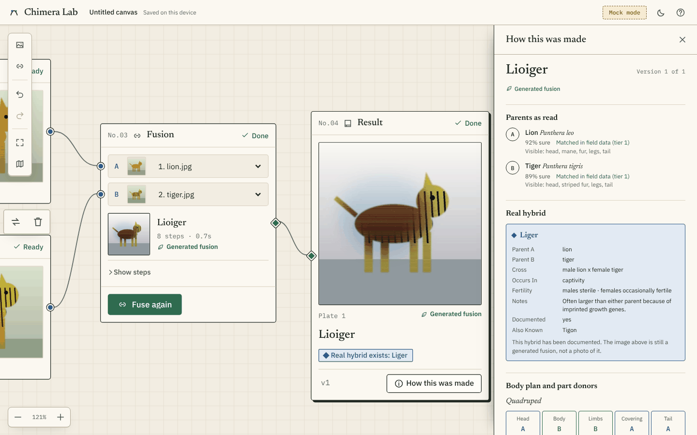 | 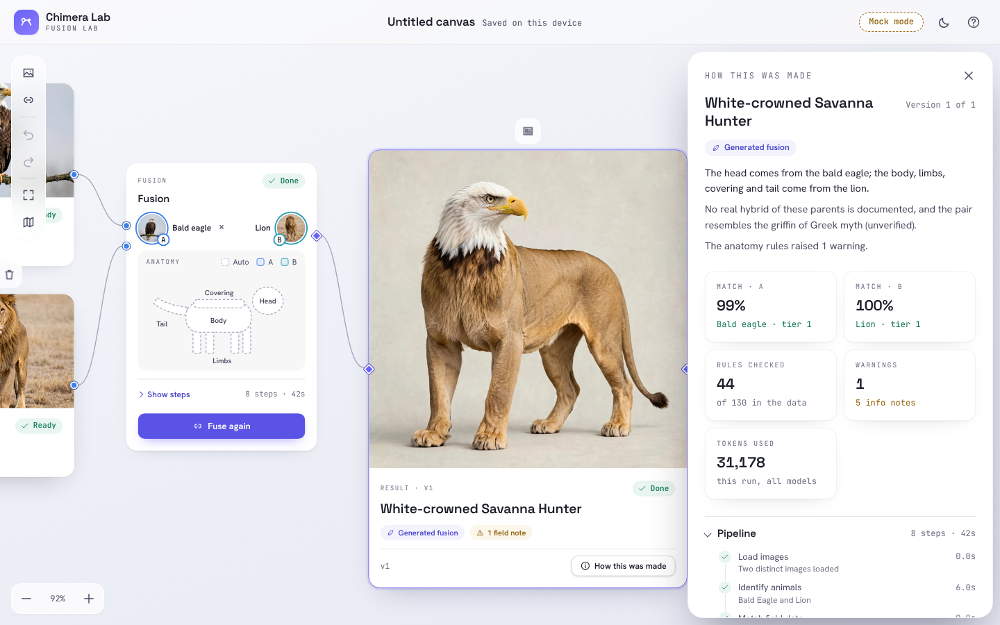 |

- **Before:** one long scroll of headed sections, starting with parents and the planner's prose.
- **After:**
  - **Summary first:** a plain three-sentence summary built from the spec (donors, real hybrids, mythology resemblance, warnings).
  - **Stat cards:** match confidence per parent, rules checked, warnings, and tokens ("unknown" when not recorded).
  - **Collapsible evidence:** pipeline Timeline with per-step durations, real hybrids, rules, and mythology. Each mythology row reads "Resembles griffin (Greek)" with an "Unverified" pill. The planner's notes are folded away.
